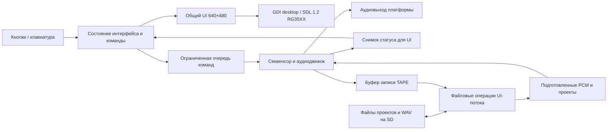
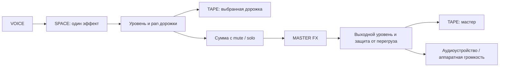

# MOSS — план нативной версии для RG35XX

Дата: 10 ноября 2026. **Текущий статус: MOSS 0.3.0 собран; аппаратная проверка ожидается.** MOSS LAB 0.1.3 и музыкальный SAMPLER-прототип 0.2.0 подтверждены пользователем на GarlicOS 1.3.9. Новый срез: библиотека 32 × 1 MiB, импорт PCM16/24/32/float WAV, ручные слайсы, захват track/master, ORBIT/POND/CRUSH и FX locks, независимая позиция каждого цикла. ORGANISM, MONO, FM и сцены ещё не реализованы.

Рабочая сборка: переносимый Zig + закреплённый uClibc SDK на Windows, без Docker/WSL. Общие C++ модель/контроллер/DSP/UI; Windows — GDI/waveOut, устройство — SDL 1.2/evdev. Ниже сохранён план дальнейших этапов; фактические границы и управление текущей версии описаны в `../native/prototype/README.md`.

## Решение

Первая целевая система — оригинальная Anbernic RG35XX пользователя с **GarlicOS 1.3.9**. Устройство доступно, пользователь может переносить ZIP-сборки через SD-карту. Это уточнение заменяет исходную цель «GarlicOS 1.4.x». Для планирования принимаются заданные пользователем ATM7039S, ARMv7, 256 MB и экран 640×480; конкретные CPU features, ABI, доступная RAM и библиотеки проверяются на устройстве.

Браузерный прототип v0.6 сохраняется как эталон структуры, оформления и управления. Нативная версия — C++17 с общей моделью проекта, секвенсором, DSP и UI. Desktop сейчас использует GDI/waveOut; RG35XX использует проверенный SDL 1.2 через изолированный платформенный слой. SDL2 остаётся возможной последующей заменой desktop backend. Версию системы пока не меняем.

Почему такой выбор: ChipNomad явно поддерживает оригинальную RG35XX с GarlicOS 1.4; его отдельная RG35xx-сборка использует `platforms/sdl12`, `-lSDL` и `nfriedly/miyoo-toolchain:steward`, тогда как desktop использует SDL2. Это практический ориентир, но не доказательство совместимости MOSS с 1.3.9. [Поддерживаемые платформы](https://github.com/Megus/chipnomad-tracker), [рецепт сборки](https://github.com/Megus/chipnomad-tracker/blob/158f6bba939d97e052514ce89ed894aed0e23202/tracker/Makefile.rg35xx).

Есть и специализированная RG35XX toolchain с patched SDL 1.2.15. Её используем как дополнительный ориентир при проблемах вывода/vsync, а не смешиваем библиотеки двух окружений. [Репозиторий](https://github.com/edemirkan/rg35xx-toolchain).

## Зафиксированный продукт

- ATLAS — проекты. Внутри проекта GRID / MIX / TAPE; внутри дорожки PATTERN / VOICE / SPACE.
- ORGANISM, MONO, SAMPLER. Глобальный TAPE отдельно: импорт, ручная нарезка, внутренний ресэмплинг, библиотека.
- Один эффект на дорожку и один на мастере. ORBIT / POND / CRUSH. Цепочки эффектов отложены по решению пользователя.
- Цикл 1–64 шага независимо для дорожки и паттерна A–D; пресеты 16/32/64. Длина ноты 1–64 шага отдельно от длины цикла.
- STEP / VOICE LOCKS / FX LOCKS / CYCLE; локи FX раздельно по типам. Probability, сцены, сохранение и восстановление.
- Фиксированные цвета четырёх слотов и тёмный графит из DESIGN.md. Аппаратные A/B/X/Y + D-pad изменяют параметры; L1/R1 выбирают объект, L2/R2 вкладку, L1+R1 OPTIONS.
- Первый гарантируемый объём проверяемой музыкальной версии: **три дорожки SLOW SIGNAL**. Текущая нативная схема хранит три дорожки; восемь остаются целью браузерного прототипа. Поддерживаемую звуковую нагрузку выше трёх определяем измерениями, не количеством строк UI.

## Архитектура



Общий код не содержит путей GarlicOS, SDL keycodes и системных аудиовызовов. Платформенные интерфейсы: видео, кнопки, аудио, пути хранения и выход. UI рисует простой набор линий, прямоугольников, текста и графиков. Собственный небольшой renderer с растровым атласом шрифта; 30 FPS как исходная цель, обновление статических областей по изменению. Никаких зависимостей от браузера или GPU для базовой версии.

Фактически сборка выполняется `native/prototype/scripts/build.cjs`: Zig вызывает компилятор и linker с закреплёнными флагами ARMv7 Cortex-A9 softfp, заголовками и библиотеками старого uClibc SDK. CMake/WSL/Docker для этого не нужны. Проверяются обе платформы и общая логика. Импорт/обновление PCM останавливает транспорт; завершённый capture сохраняется из неизменяемого буфера параллельно продолжающемуся аудио. Файловых операций в render нет.

## Этапы и критерии перехода

| Этап | Что создаём | Что должно работать на устройстве |
|---|---|---|
| 0. MOSS LAB | Окружение сборки, упаковка и маленькая диагностическая программа | Запуск на GarlicOS 1.3.9, экран 640×480, все кнопки и сочетания, тихий тестовый тон, запись отчёта на SD и штатный выход |
| 1. Native shell | ATLAS/GRID, редактор дорожки и четыре параметра; общий UI/input; сохранение проекта | Те же жесты, что в браузере; создание проекта/дорожек, имя, сохранение/повторное открытие без аудио |
| 2. Первый музыкальный цикл | Аудиочасы, MONO, три дорожки, независимые циклы, length, probability, voice locks | Ноты звучат в правильный момент; 7/15/16 шагов, нота на 16 шагов, изменение параметров во время игры без зависания UI |
| 3. Реальный SAMPLER | PCM16 WAV, библиотека, назначения, pitch/start/end/level, gate/loop/one-shot, PCM-кэш | Короткий WAV играет на выбранной клавише; одинаковый asset не дублируется в RAM; пустые клавиши пропускаются; превышение бюджета объясняется |
| 4. Тембры и эффекты | ORGANISM, CRUSH, ORBIT, затем POND; текущие FX locks; MIX | Три разных инструмента плюс мастер, работающие ручки/локи, отсутствие щелчков от обычных изменений; замер каждого эффекта отдельно и вместе |
| 5. TAPE | Захват track/master, потоковая запись WAV, ручной trim/split, сохранение небольших assets | Записать дрон, выделить короткий фрагмент, сохранить, назначить SAMPLER и сыграть его, не покидая консоль |
| 6. Сцены и первая alpha | Подготовка следующей сцены, переключение на границе, сохранение/восстановление, SLOW SIGNAL | Полный пользовательский сценарий от пустого проекта до трёх дорожек, ресэмплинга, смены сцены и открытия после перезапуска |

После каждого этапа собираем desktop и RG35XX из одного состояния исходников. На консоль идёт маленькая версия с номером и коротким сценарием проверки. Если проверка платформы или аудио не проходит, следующий слой не маскирует проблему.

## Этап 0: точная задача MOSS LAB

Первая поставка — `MOSS-LAB-<build>.zip` с launcher, binary, необходимыми локальными ресурсами и инструкцией копирования в APPS. Конкретные mount paths определяются диагностикой и местом запуска, а не жёстко прописанным `/mnt/...`. Программа не заменяет библиотеки ОС и не меняет настройку прошивки.

Последовательно проверяем:

1. Успешный запуск простого ARM binary и C++ runtime. Версии libc/libstdc++, ELF interpreter, float ABI и доступные инструкции. Название `steward` закрепляется digest/версией после успешного запуска; нельзя подменять его плавающим `latest`.
2. Доступный видеорежим, формат пикселей, корректные границы 640×480, время полной и частичной перерисовки. 640×480×4×2 ≈ 2.34 MiB только на два RGBA-буфера; это расчёт, не измерение драйвера.
3. Все D-pad, A/B/X/Y, L1/R1/L2/R2, Start/Select/Menu. Особенно modifier + стрелка, L1+R1, отпускание, длинное удержание и одновременные кнопки. Пропущенное отпускание не должно оставлять бесконечное редактирование.
4. SDL events / доступ к Linux input. В ChipNomad есть таблица для `j2k.so`; это возможный путь совместимости, не таблица, которую можно без проверки объявить нашей аппаратной раскладкой. Выбираем SDL/evdev/совместимый mapper по фактическому результату, изолируем в InputBackend. [Исходная таблица](https://github.com/Megus/chipnomad-tracker/blob/158f6bba939d97e052514ce89ed894aed0e23202/tracker/platforms/shared/corelib_keymap.h).
5. Аудиовыход через доступный SDL 1.2 backend: фактический драйвер и формат, 44.1/48 kHz, stereo PCM16. Начинаем с 1024/512 frames, проверяем 256 при запасе. Не предполагаем заранее ALSA вместо OSS или конкретное устройство вывода. Проверяем динамик, наушники, аппаратную громкость и закрытие аудио при выходе.
6. Время callback, свободную RAM и RSS процесса, поведение под перерисовкой и активным вводом. Статистику складываем в заранее выделенный буфер и записываем вне аудиопотока. Недогрузки драйвера считаем, если backend даёт счётчик; пропуски deadline callback измеряем отдельно и не выдаём за полное измерение underrun.
7. Доступный каталог данных, скорость/паузы записи на SD, сохранение и повторный запуск. Определяем реакцию на системный выход/сон; не предполагаем, что приложение всегда получит уведомление перед выключением.

Результат: локальный отчёт `reports/<build>-<device>.json` с явными PASS/FAIL/UNAVAILABLE. Пользователь копирует отчёт обратно и описывает слышимые дефекты. ADB/SSH — только если реально доступны; основной цикл проверки работает через SD.

## Правила аудиодвижка

Аудиопоток владеет музыкальным временем и состоянием DSP. UI отправляет ограниченные команды и читает компактные снимки статуса. Фоновый worker читает/пишет файлы, готовит PCM и снимки сцен. В callback не должно быть выделения/освобождения памяти, чтения SD, сохранения JSON, блокирующих mutex, печати логов или ожидания UI.

У очереди фиксированная ёмкость, непрерывные изменения параметров можно объединять. Важные команды не теряются молча при переполнении. Публикация подготовленных данных идёт по идентификатору/поколению; освобождение старого asset выполняется после подтверждения аудиопотока, вне callback. На 32-битной цели не предполагаем автоматически lock-free для 64-битных atomics или `shared_ptr`.

Внутренние расчёты — float32, выход первоначально PCM16; scalar реализация обязательна, SIMD — отдельная измеренная оптимизация. Числа ограничиваются, NaN/denormal и нестабильная обратная связь обрабатываются. Сглаживание параметров, короткие fades при старте/остановке и запас уровня нужны с первого звука. Частота устройства берётся из реально полученной конфигурации.

Пробуем 44.1 kHz и 48 kHz. 512 frames при 44.1 kHz ≈ 11.61 ms, 256 ≈ 5.80 ms — **только длительность одного блока**, не полная задержка кнопка→звук. Система может добавлять буферы; SDL также может изменить запрошенный размер. [Документация SDL](https://wiki.libsdl.org/SDL2/SDL_OpenAudioDevice). Для оригинальной RG35XX у ChipNomad есть отдельный SDL 1.2 audio callback с PCM16 stereo, что подтверждает подход к платформенному разделению, а не показатели задержки MOSS. [Код backend](https://github.com/Megus/chipnomad-tracker/blob/158f6bba939d97e052514ce89ed894aed0e23202/tracker/platforms/sdl12/corelib_audio.cpp).

Исходные цели для профилирования: интерфейс 30 FPS; DSP при обычном SLOW SIGNAL занимает не более примерно половины периода callback, чтобы оставался запас. Это критерии разработки, а не обещанные измерения. Пики и просроченные callback важнее средней загрузки CPU. Фиксируем режим питания/частоты, чтобы сравнение сборок было честным.

## Семантика секвенсора до подключения синтов

Следующие правила — предлагаемый контракт звуковой версии; их фиксируем тестами прежде, чем реализовывать сложные тембры.

- Общий музыкальный tick с дробным накоплением; события размещаются внутри аудиоблока по sample offset. Браузерный таймер не переносится в движок.
- Позиция дорожки = tick modulo длина её текущего паттерна. Например, 7 и 15 снова совпадают через 105 шагов. Граница другой дорожки или master cycle не сбрасывает этот счёт.
- LENGTH — длительность до note-off в музыкальных шагах. Темп меняется без сброса позиции. Старый note-off содержит generation id и не может оборвать новую ноту после retrigger.
- Для первой версии каждый шаг содержит одну ноту. MONO и ORGANISM — один нотный голос на дорожку; ORGANISM внутри голоса содержит несколько осцилляторов. SAMPLER начинает с одного активного голоса и ограниченного короткого хвоста для мягкого retrigger. Аккорды и свободная полифония не требуются для текущего UI.
- Для длительной ноты через цикл не создаётся дополнительный триггер автоматически. Следующий успешный триггер этой дорожки перезапускает голос; пропуск по probability не отменяет уже запланированный note-off.
- Probability воспроизводима при одинаковом seed и позиции. RNG привязан к проекту/дорожке/паттерну/номеру цикла, а не к частоте обновления UI.
- В первой реализации локи срабатывают вместе с успешным триггером и действуют один шаг. На следующем шаге используются базовые параметры либо новые локи; сохранённый preset не меняется. LENGTH ноты и длительность лока — разные вещи. Это решение проверяем на слух в этапах 2/4 и при необходимости явно меняем контракт.
- Неназначенный или отсутствующий sample key не заменяется автоматически. STEP перебирает только существующие назначения с доступным PCM.
- Смена A–D и сцены — по явно определённой границе, с общим reset позиций. Полные сцены включают состав дорожек, все паттерны, длины, инструменты/FX и назначения. Файлы PCM не копируются в сцену.

## Движки: порядок и объём

| Модуль | Начальная реализация | Основной риск / проверка |
|---|---|---|
| MONO | Простой ограниченный по спектру осциллятор, устойчивый фильтр, attack/release | Высокие ноты, крайние cutoff/resonance, retrigger и длинная нота |
| SAMPLER | PCM16 в RAM, fractional playhead, интерполяция pitch, границы start/end, короткие fades и loop | Выход за границы, смена pitch/start/end на локах, missing asset, RAM |
| ORGANISM | Предложение: четыре связанных осциллятора, медленный drift и сглаженная случайная модуляция; density смешивает их вклад | Звук и связи TENSION/DRIFT/CHAOS/DENSITY нужно подобрать на слух, график прототипа не является DSP-спецификацией |
| CRUSH | Drive/waveshaping, bit depth, sample hold по rate, wet/dry | Уровень, DC, резкие изменения; изоляция намеренного aliasing redux от случайных щелчков |
| ORBIT | Предвыделенный stereo delay, tempo sync, feedback, spread и mix | Длинные времена при медленном BPM, feedback, изменение time без пересоздания буфера |
| POND | Компактная сеть обратных задержек с фильтрацией, early reflections, decay/damping/mix | Пики CPU, хвост, устойчивость и качество на исходной частоте устройства |

CRUSH и ORBIT вводятся раньше POND. Каждый модуль получает offline-render тесты и отдельный аппаратный замер; включаем их сочетания постепенно. Реализация CRUSH принципиально не требует длинных буферов: это вывод из структуры простого waveshaper и sample hold, не результат измерения RG35XX. [Waveshaper](https://www.musicdsp.org/en/latest/Effects/41-waveshaper.html), [bitcrusher](https://audio.js.org/modules/effect-bitcrusher/).

При выборе готовых DSP-компонентов фиксируем происхождение, лицензию, версию и стоимость. Не тащим большой framework ради одной функции; тяжёлые оптимизации принимаем только по профилю. Сторонний tracker служит ориентиром интеграции, его музыкальное поведение и UI не становятся поведением MOSS.

## Память, файлы и TAPE

256 MB — полная RAM устройства, а не бюджет приложения. Начальная цель RSS ≤64 MiB — предварительная и пересматривается после LAB. Предварительный активный PCM-лимит остаётся 8 MiB, один asset ≤1 MiB. Отдельно учитываем подготовку следующей сцены, ещё звучащие старые голоса, буферы эффектов, запись, framebuffer и временную память. Запас для подготовки сцены нельзя считать частью свободных 8 MiB активного набора.

При 44.1 kHz PCM16: mono ≈86.1 KiB/s, stereo ≈172.3 KiB/s; 1 MiB — около 11.89 s mono или 5.94 s stereo. Это удобный размер небольшого музыкального материала; нарезка не обязана попадать в заранее заданную сетку. Один и тот же asset, назначенный нескольким клавишам, загружается один раз. Pitch/start/end — свойства назначения, а не копия файла.

Длинный WAV в TAPE читается блоками; обзорная waveform строится как компактная таблица min/max. Ручные границы хранятся в sample frames, UI может показывать миллисекунды. При SAVE выбранные участки физически пишутся отдельными короткими WAV. Само изменение START/END в SAMPLER не уменьшает исходный asset в RAM. Ресэмплинг разных sample rates при импорте выполняется в worker, не в callback; исходный файл сохраняется.

TAPE capture копирует нужную шину в фиксированный ring buffer; worker постепенно пишет WAV на SD и завершает заголовок. При отставании записи переполнение останавливает захват с понятной ошибкой, не блокируя воспроизведение. Повреждённый незавершённый файл не публикуется как готовый sample; предусмотрены восстановление/отмена.

Предлагаемая маршрутизация:



Выбранная дорожка пишется с её SPACE и level/pan, до master FX; mute управляет попаданием в общий микс. Мастер пишется после master FX и выходной обработки, до аппаратной громкости. Захват заданного количества bars использует музыкальное время; длительность WAV может меняться, если меняется BPM. Источник/количество bars во время записи остаются зафиксированными.

## Сцены, сохранение и восстановление

IO worker заранее загружает PCM следующей сцены и подготавливает её данные. На нужной границе аудиопоток переключает подготовленные ссылки без файловых операций. Если память не позволяет держать оба набора, UI предлагает остановить и загрузить сцену; не обещаем бесшовность при любом размере проекта.

Для одинакового типа FX при смене сцены сглаживаем параметры и сохраняем допустимый хвост. При замене алгоритма — короткий crossfade/затухание с ограниченным бюджетом; длительное параллельное звучание двух полных графов не предполагается по умолчанию. Точная политика хвостов утверждается прослушиванием до alpha.

JSON с версией схемы хранит проект; PCM хранится отдельными файлами и адресуется стабильным asset ID/относительным путём. Сцены используют ссылки. Сохранение: новый временный файл → flush/fsync, если доступно → переименование с резервной копией. На FAT/SD нельзя обещать абсолютную атомарность при физическом выключении; после запуска валидируем основной и резервный файлы, предлагаем восстановление. Autosave группирует изменения, не пишет на SD при каждом шаге стрелки.

Импорт JSON браузерной v0.6 поддерживается через явную миграцию. Синтетические metadata-assets прототипа не являются реальным звуком: они помечаются missing, либо демо получает специально сгенерированные движком WAV. Их имена не используются как доказательство наличия PCM. SLOW SIGNAL для нативной alpha собирается из настоящих инструментов и коротких собственных ресэмплов.

## Проверки и завершение первой alpha

Автоматически: миграция проектов, JSON round trip, границы 1/7/15/16/17/31/32/63/64, note-off через wrap и retrigger, probability 0/100 и фиксированный seed, смена BPM, FX lock restore, voice limits, bounds WAV, очередь сцен, общие assets и нехватка RAM. Offline audio проверяет конечные значения, уровень, длину, клики на границах и повторяемость в рамках платформы. Между разными CPU сравниваем допуски и события, не требуем побитового совпадения float.

На устройстве после каждого этапа: запуск, повторный запуск, кнопки/аккорды, звук и краткий отчёт. На alpha: не менее 30 минут SLOW SIGNAL с активным редактированием, сменой экранов и ресэмплингом; затем длительный прогон 2 часа, сохранение/восстановление и сцены с разными наборами PCM. Проверяем плохой WAV, missing file, заполненную SD, отказ записи, полную очередь и попытку превысить RAM. Без намеренного повреждения рабочей карты пользователя.

Первый законченный сценарий: создать проект → записать длинный ORGANISM drone → добавить редкие MONO ноты с probability → ресэмплировать дрон в TAPE → вручную сохранить короткий WAV → назначить SAMPLER → выбрать разные циклы дорожек → поставить CRUSH/ORBIT/POND и локи → сохранить сцены → выйти → открыть и воспроизвести. Весь сценарий выполняется без компьютера после установки сборки.

## Организация проекта и следующий шаг

```text
MOSS/
  visual prototype/       эталон v0.6
  native/                 будущий общий C++ проект
    core/                 проект, паттерны, команды, миграции
    audio/                транспорт, голоса, DSP, mixer, capture
    ui/                   состояния экранов, layout, draw commands
    platform/desktop/     SDL2
    platform/garlicos/    SDL 1.2, input, launcher, storage
    storage/              WAV, assets, JSON, фоновые операции
    tests/                модель, offline audio, input replay
    tools/                сборка и упаковка
  hardware lab/           будущий probe и возвращённые отчёты
  docs/                   контракт, решения и аппаратные результаты
  design/current/         актуальные UI-диаграммы
```

Сегодня создаются только план и навигационные README этих новых папок. Нативные модули из дерева выше — запланированная структура, не готовая реализация.

**Первый рабочий пакет:** настроить воспроизводимую сборку и выпустить MOSS LAB для GarlicOS 1.3.9. Пользователь запускает его с SD и возвращает отчёт. Его результат определяет окончательные ABI, input/backend, частоту/буфер и доступную память; после этого начинается native shell и первый MONO-секвенсор.

Открытые аппаратные вопросы: точный ABI и библиотеки 1.3.9, доступный аудиодрайвер, фактические сочетания кнопок, доступная RAM, интервалы задержек SD, поведение выхода/сна. Они решаются LAB, а не дополнительной догадкой по характеристикам похожей RG35XX Plus.

## Уточнение: основной цикл разработки на компьютере

Пользователь предложил запускать GarlicOS в Docker, чтобы уменьшить переносы на устройство. Цель принимается: большинство итераций выполняем на ПК. Полную аппаратную эмуляцию GarlicOS 1.3.9 не считаем доступной.

Docker предоставляет окружение процессов и сборки с ядром Linux хоста/виртуальной машины; он сам не воспроизводит ядро и периферию RG35XX. Полный запуск образа требует модели платы/SoC в системном эмуляторе. В опубликованном списке плат QEMU оригинальная RG35XX/ATM7039S не указана. QEMU отдельно предупреждает, что образ одной ARM-платы обычно не загружается на другой. Это ограничение найденного стандартного пути; утверждения, что никакого экспериментального эмулятора не существует, нет. [Docker](https://docs.docker.com/get-started/docker-concepts/the-basics/what-is-a-container/), [QEMU ARM](https://www.qemu.org/docs/master/system/target-arm.html).

Три уровня проверки:

1. **Desktop MOSS — каждый цикл редактирования.** Один и тот же C++ core/DSP/UI в окне 640×480, клавиатура как кнопки, реальный звук через desktop backend. Проверяем музыкальные сценарии, локи, длины, сэмплы, проекты и сцены. Задаём программные бюджеты PCM/голосов; они проверяют политику приложения, а не моделируют скорость консоли.
2. **Docker builder + QEMU user-mode — автоматические проверки ARM.** Закреплённая toolchain собирает ARM binary и headless test runner. После получения подходящего загрузчика/библиотек из окружения GarlicOS 1.3.9 пробуем запуск ARM-тестов: загрузка библиотек, расчёты, сериализация, offline WAV render. Аудио/видео/кнопки в этом режиме заменены тестовыми backend. Это проверка части userspace-совместимости, не всех kernel/device API. [QEMU user-mode](https://www.qemu.org/docs/master/user/main.html).
3. **RG35XX — первый LAB, интеграционные этапы и аппаратные изменения.** Проверяем настоящий вывод, сочетания кнопок, underrun, CPU/RAM, запись SD и сон/выход. При изменении только layout или музыкальной логики достаточно сначала desktop/автотестов; при изменении платформенного слоя, аудиобуфера, DSP-нагрузки или IO возвращаемся к устройству.

Ограничение контейнера до 256 MB не воспроизводит доступную память GarlicOS; эмулятор не даёт достоверной оценки realtime-производительности ATM7039S. Измерения задержки/CPU из desktop или QEMU не используются как результаты консоли.

Таким образом, LAB нужен в начале для подтверждения платформы, а далее перенос на SD делается для проверенных контрольных сборок, не после каждой правки. Подготовка Docker/QEMU пока не выполнена.


## MOSS 0.2.0 — первый музыкальный срез, 10 ноября 2026

LAB 0.1.3: пользователь подтвердил воспроизведение сэмплов и THREE. Два возвращённых отчёта: 35 запусков WAV, 11 с тремя голосами, ошибок аудио нет, over_budget=0 и late_intervals=0. Максимальный callback 3969 µs при периоде 1024/44100 ≈ 23220 µs (около 17% периода); максимальная загрузка файла 33432 µs, RSS до 2728 KiB. Последний сеанс завершён штатно. В первом отчёте есть ручные отметки SILENT/CLICKS, поэтому одни тайминги не считаем доказательством отсутствия слышимых дефектов. SD write/read пока не протестирован.

Начата отдельная native/prototype: три дорожки SAMPLER, GRID/PATTERN/VOICE/MIX, 1–64 шага, длина 1–64, velocity/probability, временные voice locks, ручные trim, назначения 12 клавиш, четыре слота проектов и Undo последнего жеста. SLOW SIGNAL — сэмплерное демо, а не реализация будущих синтезаторов. TAPE/SPACE явно недоступны. Следующие этапы: аппаратная проверка длительного воспроизведения и сохранения, затем синтезаторы/эффекты, динамическая библиотека, TAPE и сцены.

Общая C++ модель/UI/DSP; Garlic использует проверенные evdev и SDL 1.2. Первый desktop backend использует Win32/GDI/waveOut, чтобы не ставить новую зависимость ради контрольного окна. SDL2 остаётся возможной заменой адаптера. Это изменение раннего плана зафиксировано явно; Windows не эмулирует производительность ARM.

Пройдены тесты: переносимое сохранение и проверка повреждения, очередь команд, независимость DSP от размера блока, циклы 7/15, note-off после 16 шагов, восстановление базы после локов, удалённое назначение, вероятность 0%, плавный STOP, аккорд курков и редактирование без потери фокуса. Собраны ARM и Windows, проверены ELF/ABI/символы SDK, просмотрены экраны; desktop запущен, проверены транспорт, редактор, меню и сохранение. Звук именно MOSS 0.2.0 на физической консоли ещё не проверен. Подробности: native/prototype/README.md.


## Native 0.2.1 · GRID и глобальный темп

Пользователь подтвердил работу музыкального прототипа 0.2.0 и ambient-банка. В 0.2.1 нативный GRID приведён к списку TRACK / VOICE / SPACE без мини-паттернов. PATTERN использует сетку 8×2, светлые включённые шаги, независимую рамку выбора, playhead, линию длительности, страницу и постоянный инспектор выбранного шага. Пресеты длины доступны через OPTIONS; сокращение цикла сохраняет скрытые шаги.

Нативное уточнение управления: SELECT + стрелки меняет BPM в шапке на любом экране открытого проекта, с ускорением удержания. На Windows это Tab + стрелки. Короткий SELECT остаётся возвратом в ATLAS; в OPTIONS закрывает меню. Удержание SELECT без стрелки не покидает экран. Оба порядка отпускания безопасны: жест не передвигает шаг и не запускает навигацию. Темп меняется без сброса музыкальных часов; один жест — один Undo. MIX: LEVEL / PAN / MASTER / MUTE; CYCLE содержит только длину дорожки. ONE SHOT показывает LENGTH OFF.

Изменения проверены тестами общей логики и музыкального движка, сборками ARM/Windows и просмотром экранов, включая неполную последнюю страницу и удержание SELECT. Физический тест новых жестов 0.2.1 ожидается. Обновление установленной карты сохраняет projects/samples/reports с проверкой контрольных сумм; полный установочный ZIP содержит исходный demo-банк для чистой установки.

## Выбор синтезаторов после 0.3.0: исследование FM-1

Проверено по актуальным первичным репозиториям 10 ноября 2026. Пока ничего из этих проектов не включено в MOSS. Прошивка целиком не переносится: аппаратная платформа FM-1 — JieLi/pi32, у MOSS — ARMv7/Linux. Оцениваем отдельные алгоритмы с собственным адаптером и замерами на RG35XX.

| Роль MOSS | Ориентир | Кандидат / решение |
|---|---|---|
| ORGANISM | LYRA-8 | Собственная связанная система осцилляторов, взаимная модуляция, медленный drift, нелинейная обратная связь. Просто расстройка обычного VA не воспроизводит эту структуру. Четыре макро TENSION/DRIFT/CHAOS/DENSITY сохраняются. |
| MONO | Mother-32 | Осцилляторы/шум/сглаживание Felucca-Engines — кандидаты. Их ANALOG использует SVF, поэтому ladder-фильтр и характер насыщения надо оценить отдельно. Не обещаем точную эмуляцию Moog. |
| FM | Дополнительный тембр | Сравнить компактный собственный 2–4-операторный алгоритм и порт шестоператорного msfa. Первая страница — четыре музыкальных макро, без обязательного редактирования десятков операторных параметров. |

**Felucca-Engines:** C99 fixed point, MIT; самостоятельные DSP-узлы и интерфейс host/voice/block. Исходники `src/eng_analog.c`, `src/dsp.c`, `src/felucca_engine.h` просмотрены. Удобный первый кандидат на изолированное сравнение. [Репозиторий](https://github.com/hugelton/Felucca-Engines), [лицензия](https://github.com/hugelton/Felucca-Engines/blob/main/LICENSE).

**FM6:** `firmware/src/fm6_core.c` Felucca — порт msfa с Apache-2.0; окружающий `eng_fm6.c` имеет GPL-3.0-only. Эти границы проверены в заголовках файлов и LICENSING.md, их нельзя считать одной лицензией. Оценивать сначала ядро и собственный интерфейс MOSS. [Ядро](https://github.com/hugelton/Felucca/blob/main/firmware/src/fm6_core.c), [лицензии](https://github.com/hugelton/Felucca/blob/main/LICENSING.md). Просмотренная ревизия Felucca: `a4f007c9211ea5b37298c01ff6d73430fe2cb96a`.

**AMB-1:** полезен для изучения неравных петель, медленных тембров, tape echo и длинной реверберации. Текущая ветка MPL-2.0; старые версии до 0.9 включительно GPL-3.0-only. Общий каталог прошивок содержит устаревшие сведения о лицензиях, поэтому ориентируемся на конкретную ревизию исходников. [Проект](https://github.com/charlesvestal/fm1-amb), [LICENSING](https://github.com/charlesvestal/fm1-amb/blob/main/LICENSING.md).

Официальный `m-vave/fm1_open` также открыт: код приложения GPL-3.0-only с отдельным разрешением на связывание, SDK-бинарники имеют отдельные условия. Не использовать SDK FM-1 для RG35XX. [Исходники](https://github.com/m-vave/fm1_open), [лицензия](https://github.com/m-vave/fm1_open/blob/main/LICENSE.md).

Ориентиры: [руководство LYRA-8](https://somasynths.com/wp-content/uploads/2020/11/LYRA-8_manual_Eng_V2_1.pdf), [руководство Mother-32](https://cdn.inmusicbrands.com/Moog/Mother32/Mother_32_Users_Manual.pdf). Следующий музыкальный тест кандидатов должен включать одинаковые ноты/громкость, медленные изменения параметров, aliasing на высоких нотах, три дорожки с эффектами, память и callback worst case. Переносимость по структуре кода — гипотеза; исполнения этих движков на RG35XX ещё не было.
