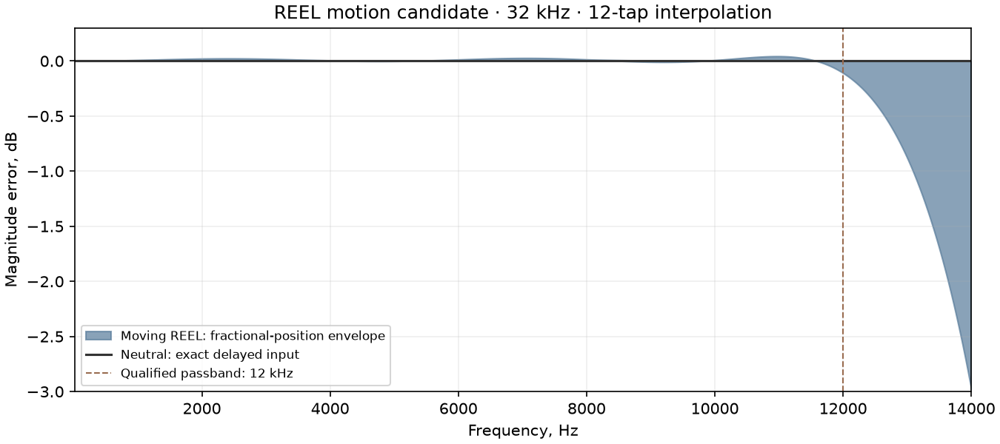

# REEL: clean path and WOW/FLUTTER audio candidate

[Русский](REEL-MOTION-v1.md) · **English**

This implements the first practical step of the [research plan](REEL-RESEARCH-PLAN.en.md): a standalone DSP component and an isolated measurement build for the original RG35XX. Installed MOSS / MOSS-GRANULAR applications, user sequences, SONG arrangements and samples are not replaced. Normal builds still use the previous REEL.

## Implementation

- Float32 history, without mandatory saturation, PCM16 clipping, noise or filtering.
- Fully processed output with **AMOUNT** controlling modulation depths. No blend with an undelayed original, so the previous fixed comb-filter mechanism is absent.
- Independent **WOW / WOW RATE / FLUTTER / FLUTTER RATE**. Depth is specified in cents and rate in hertz; faster movement does not silently increase steady-state depth.
- Approximately 50 ms control smoothing, continuous oscillator phase, bounded head velocity during abrupt locks. Stereo channels share the movement. Additional DRIFT and STEREO controls remain future work.
- A normalized 12-tap Kaiser fractional-delay filter, with 256 phases and coefficient interpolation. Zero depth uses exact integer-sample reading.
- The same filter is vectorized on ARM. There is no load-dependent quality switch. Ring seams and startup use the equivalent portable calculation.

| Control | Candidate range |
|---|---|
| WOW | 0–15 cents |
| WOW RATE | 0.10–4 Hz |
| FLUTTER | 0–15 cents |
| FLUTTER RATE | 2–30 Hz |
| AMOUNT | 0–100%; scales depth, not rate |

WOW and FLUTTER deviations add together; 15 cents per mechanism is not a 15-cent combined limit. Abrupt parameter changes can temporarily exceed steady-state depth. The extreme test alternates range endpoints every 15 ms and measures approximately −47…+46 cents, with continuous reading and bounded head velocity. This is a pitch transition, not an instantaneous switch between two settled modulation depths.

## Latency and neutrality

The main candidate reserves **16 ms per instance**, rounded to an integer sample: 512 samples at 32 kHz. Every track in the laboratory build retains the same base latency through bypass, and the master adds another 16 ms. Total additional latency is therefore 32 ms, on top of existing application buffering. Bypass smoothly removes modulation while retaining history and latency; once settled, the output exactly matches the delayed input.

A separate 6 ms listening experiment uses WOW=4 cents / 0.3 Hz and FLUTTER=1 cent / 6 Hz. It does not support the entire proposed range: WOW=15 cents / 0.1 Hz needs about 13.85 ms of travel in one direction. The broad ambient-WOW candidate therefore uses 16 ms. Its playing feel still needs evaluation before user integration. Listening files are time-aligned and cannot demonstrate control latency.

**Scope boundary:** four-track/master alignment is exercised in the isolated build. Production preview, monitoring, capture and insert-reordering latency handling is not released. Existing preview audio enters after master FX; simply enabling the experimental flag in a user build would not align that path.

## Audio evidence

Raw results: [audio-metrics.json](verification/reel-motion-v1/audio-metrics.json), [audio-levels.csv](verification/reel-motion-v1/audio-levels.csv).

- Neutral float output is bit-exact after latency compensation, including headroom above 0 dBFS, at 8 / 32 / 44.1 / 48 / 96 kHz. Reset does not leak old history.
- All five original musical fixtures produce identical aligned PCM16 files in neutral mode. There is no mandatory gain reduction.
- At 32 kHz, the worst fractional-position magnitude error from 100 Hz to 12 kHz is **0.108745 dB**. The calculated response also covers 20–100 Hz.
- At 14 kHz, the worst fractional-position attenuation reaches approximately **2.98 dB**. This is a limitation of the short interpolator during motion, not a TONE control. It is absent in neutral mode. The candidate meets the 12 kHz target, not a flat moving response all the way to Nyquist.
- Isolated LFO rates measured from head movement differ from their targets by less than 0.006%. Modulation depth fitted to the actual 1 kHz output tone is approximately **10.00–10.03 cents** for a 10-cent setting.
- Moving-tone RMS differs by less than 0.006 dB. RMS error against an ideal moving sine is approximately 0.00028–0.00032: the finite filter has small amplitude and phase errors. This is not a neutral-path error or an analog-output measurement.
- ARM vector output versus an independent scalar oracle: 30,000 fractional/ring/stereo combinations, maximum absolute difference **0.000000715**.



Original bass, drums, pad, noise texture and full-mix fixtures are rendered as dry audio, old neutral REEL, old wobble, new neutral, gentle motion, deep WOW, fast FLUTTER and the short-latency candidate. Separate `*-matched.wav` files match overall RMS for audition; measurement files remain unnormalized. These fixtures contain no commercial sample-pack material.

The concise `work/reel-motion/audio/pad-audition.wav` file contains dry audio at 0–8 s, deep WOW at 8–16 s and fast FLUTTER at 16–24 s. Segment boundaries have 20 ms fades; measurement renders are unchanged.

This work provides measurements and A/B material. It does not substitute for the user's subjective audition or a recording of the RG35XX analog output. Sound equivalence to GrainBrick, RC-20 or Elektron is not claimed.

## Application and hardware verification

Hardware results: [manifest.json](verification/reel-motion-v1/manifest.json). **13 short runs and one long run, 1,326 seconds total, 41,469 audio callbacks; recorded audio faults, queue overflows and slow UI frames: zero.** The candidate itself ran for 1,176 seconds / 36,774 callbacks. The installed MOSS-GRANULAR executable was additionally checked by SHA-256 and remains unchanged.

The long REEL+POND run was stopped cleanly **at the user's request after 906 seconds (15:06)** instead of the original 1,200 seconds. Maximum callback: 26.753 ms; p99 ≤23 ms; 91 completed captures. The original report deliberately retains `profile_passed:false` because its original duration target was unmet. All audio/system error counters are zero; the shortening and reason are recorded separately. This validates the actual observed interval, not a completed 20-minute test.

| FX pair, 5 simultaneous REEL instances | Old mean | New mean | Difference | New p99 |
|---|---:|---:|---:|---:|
| ORBIT + REEL | 18.800 ms | 20.013 ms | +1.213 ms | ≤22.50 ms |
| POND + REEL | 20.539 ms | 21.157 ms | +0.618 ms | ≤23.75 ms |
| CRUSH + REEL | 17.439 ms | 18.043 ms | +0.604 ms | ≤20.50 ms |
| DRIVE + REEL | 19.267 ms | 20.582 ms | +1.315 ms | ≤23.00 ms |

The early 1.5 ms incremental budget for five active REEL instances is met in all paired comparisons. Overall candidate maximum: **26.848 ms against a 32 ms deadline**. The stricter p99≤24 ms target is not met everywhere: POND+DRIVE without active REEL, but with laboratory latency compensation, reached p99≤26 ms versus ≤24 ms for the baseline. Bypass/compensation cost needs improvement during integration. This candidate is **not marked as a qualified user release**: routing, final UI, audition and cold-boot validation of the completed build remain.

Profiles use four tracks at the maximum cycle length of **512 units of 1/64 note**: 64, 128, 256 or 512 visible cells at 1/8, 1/16, 1/32 or 1/64 respectively. Up to eight long grains per track or four sampler cells per track, 32 source assets totaling 32 MiB at 96 kHz, two active FX on every track and two on the master. Five simultaneous REEL instances run with ORBIT, POND, CRUSH and DRIVE. Separate profiles cover POND+DRIVE without REEL motion, mixed instruments, SONG, SWING/SHIFT, LOCK ONLY/REPEAT, live LENS drawing and repeated capture writes to SD. Stress output is muted **after** all DSP has run.

CPU frequency is the standard 1.008 GHz, without overclocking. The audio block is 1024 samples / 32 ms. Old/new runs alternated on the same device, followed by the shortened REEL+POND soak. Mean, p99, maximum, deadline misses, underruns and queue overflows are checked, along with successful audio-thread priority assignment. The report's `audio_realtime_error` field is a scheduling-priority error, not measured clock drift. Average FPS alone is insufficient.

**User-agreed testing policy:** intermediate DSP edits use focused runs of about 2–3 minutes; the full matrix is reserved for substantial changes or completed-build qualification. Twenty minutes is not a mandatory standard. The device launcher now defaults to the quick mode (160 seconds of profiles plus ARM checks); `--full-matrix` includes all combinations and a three-minute soak. The exact originally executed series is archived as [executed-hardware-series.sh](verification/reel-motion-v1/executed-hardware-series.sh).

Host checks also cover existing DRIVE/ORBIT, SWING and LOCK ONLY/REPEAT. The latter two suites also pass with the candidate enabled. The new module passes undefined-behavior checks. An intermediate ARM register-preservation failure was fixed before the qualification build: the vector kernel declares physical D-register clobbers rather than only Q aliases, which this compiler configuration handled incorrectly.

## Files and reproduction

- [DSP](../native/prototype/src/reel_motion.h), [lookup data](../native/prototype/src/reel_tables.h), [table generator](../native/prototype/scripts/reel-tables.py).
- [Tests](../native/prototype/tests/reel_motion_test.cpp), [audio renderer](../native/prototype/tests/reel_motion_render.cpp), [analysis](../native/prototype/scripts/reel-motion-analyze.py).
- [Build](../native/prototype/scripts/reel-motion.cjs), [device launcher](../native/prototype/scripts/reel-motion-device.py), [hardware series](../native/prototype/scripts/reel-motion-device.sh).

From the repository root:

```text
python native/prototype/scripts/reel-tables.py
node native/prototype/scripts/reel-motion.cjs --render
python native/prototype/scripts/reel-motion-analyze.py
```

Analysis requires NumPy; plots additionally require Matplotlib. Audio is written to `work/reel-motion/audio`. The build uses the existing local ARM SDK/Zig installation. Hardware launch separately requires an idle connected console in Garlic and a fresh test-directory name. It refuses to replace an existing directory or run over a user's MOSS session.

The table is generated by original code using standard mathematics; see [Julius O. Smith, Windowed Sinc Interpolation](https://www.dsprelated.com/freebooks/pasp/Windowed_Sinc_Interpolation.html) for the general method. No third-party effect implementation was ported. Coefficient preparation stays outside the per-sample loop. Memory is fixed: 32,844 bytes per instance plus shared lookup tables. The laboratory build temporarily retains the old REEL state too; removing it belongs to production integration.

After A/B and latency evaluation, subsequent stages add independent DRIVE/TONE/BUMP/LOSS, then HISS/FOLLOW/DROP and complete lockable controls. A user build still requires aligned preview/capture paths, final parameter banks and hardware qualification of that exact build.
