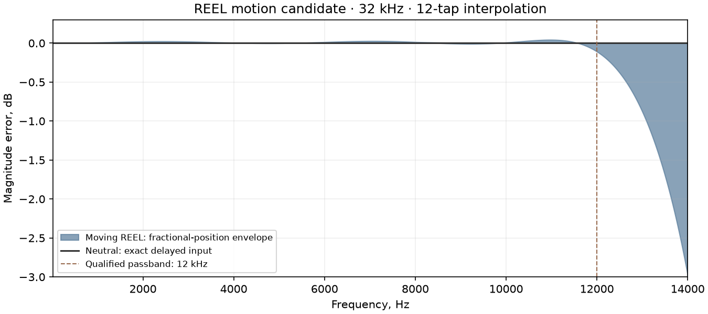

# REEL: чистый тракт и WOW/FLUTTER, первый аудиокандидат

**Русский** · [English](REEL-MOTION-v1.en.md)

Следующий завершённый лабораторный этап: [насыщение, окраска и оптимизация](REEL-COLOR-v1.md). Результаты ниже относятся к первоначальному кандидату движения.

Реализация первого шага [исследовательского плана](REEL-RESEARCH-PLAN.md). Это автономный DSP-модуль и отдельная сборка для измерений на оригинальной RG35XX. Установленные MOSS / MOSS-GRANULAR, пользовательские секвенции, SONG и библиотека не заменяются. Обычная сборка по-прежнему использует прежний REEL.

## Что сделано

- История звука в float32, без обязательного насыщения, ограничения до PCM16, фонового шума или фильтра.
- Полностью обработанный сигнал с регулятором **AMOUNT**, который меняет глубину колебаний. Незадержанный оригинал не подмешивается: прежняя постоянная гребёнка исключена из этой схемы.
- Независимые **WOW / WOW RATE / FLUTTER / FLUTTER RATE**. Глубина задаётся в центах, скорость в герцах. Увеличение скорости не означает скрытого увеличения глубины.
- Сглаживание управления около 50 ms, непрерывная фаза LFO, ограничение скорости перемещения головки при жёстких локах. Обе стороны стерео движутся вместе; дополнительные DRIFT/STEREO оставлены следующему этапу.
- 12-точечное чтение дробной позиции: нормированное окно Kaiser, 256 фаз с интерполяцией коэффициентов. Нулевая глубина использует точное чтение целого отсчёта.
- На ARM тот же фильтр вычисляется векторно. Это не переключение качества по нагрузке; кольцевой шов и заполнение истории используют эквивалентный переносимый расчёт.

| Параметр | Диапазон кандидата |
|---|---|
| WOW | 0–15 cents |
| WOW RATE | 0.10–4 Hz |
| FLUTTER | 0–15 cents |
| FLUTTER RATE | 2–30 Hz |
| AMOUNT | 0–100%; меняет глубины, не частоты |

При одновременных максимумах WOW и FLUTTER их отклонения складываются. ±15 cents каждого механизма не означают общий предел ±15 cents. Жёсткие изменения параметров могут временно дать большее отклонение: измеренный экстремальный сценарий переключает края диапазона каждые 15 ms и даёт примерно −47…+46 cents, с непрерывным чтением и ограниченной скоростью головки. Это музыкальная переходная расстройка, а не обещание мгновенного перехода между двумя стационарными глубинами.

## Задержка и чистый тракт

Основной кандидат резервирует **16 ms на экземпляр**, округлённые до целого отсчёта. При 32 kHz это 512 отсчётов. Четыре дорожки в лабораторной сборке имеют одинаковую базовую задержку даже при bypass; мастер добавляет ещё 16 ms. Итого 32 ms дополнительно к буферизации приложения. Bypass сводит движение к нулю, сохраняя задержку и историю; на остановившейся головке результат точно равен задержанному входу.

Также отрендерен короткий эксперимент с 6 ms, WOW=4 cents / 0.3 Hz и FLUTTER=1 cent / 6 Hz. Он не претендует на полный диапазон: для WOW=15 cents / 0.1 Hz требуется около 13.85 ms хода только в одну сторону. Поэтому основной кандидат для широкого эмбиентного WOW — 16 ms. Ощущение игры при этой задержке ещё нужно оценить перед пользовательской интеграцией. Файлы для сравнения звука выровнены по времени и не позволяют оценить задержку управления.

**Граница этого этапа:** выравнивание четырёх дорожек и мастера проверяется в отдельной сборке. Производственная компенсация задержки preview, мониторинга, ресэмплинга и смены порядка вставок ещё не выпускается. Сейчас предпрослушивание в приложении добавляется после мастер-эффектов; нельзя просто включить экспериментальный флаг в пользовательской сборке и считать этот путь согласованным.

## Измерения звука

Сырые значения: [audio-metrics.json](verification/reel-motion-v1/audio-metrics.json), [audio-levels.csv](verification/reel-motion-v1/audio-levels.csv).

- Neutral: побитовое совпадение float после компенсации задержки, в том числе для уровней выше 0 dBFS, на 8 / 32 / 44.1 / 48 / 96 kHz. После reset старая история не появляется.
- Все пять оригинальных музыкальных примеров в neutral также совпадают с исходными PCM16-файлами после выравнивания. Нет скрытого обязательного изменения уровня.
- При 32 kHz на дробных позициях худшее отклонение уровня в диапазоне 100 Hz–12 kHz — **0.108745 dB**. Между 20 и 100 Hz отдельно проверяется расчёт характеристики.
- На 14 kHz в наиболее неблагоприятной дробной позиции спад достигает примерно **2.98 dB**. Это предел выбранного короткого интерполятора при движении, не новая настройка TONE. В neutral его нет. Кандидат соответствует цели до 12 kHz, но не обещает плоский движущийся тракт до Nyquist.
- Частоты одиночных LFO по чтению головки отличаются от заданных менее чем на 0.006%. Глубина, измеренная по фазе выходного тона 1 kHz при заданных 10 cents, составляет примерно **10.00–10.03 cents**.
- На движущемся тоне RMS меняется менее чем на 0.006 dB. Ошибка относительно идеальной движущейся синусоиды около 0.00028–0.00032 RMS: конечный фильтр имеет небольшие амплитудную и фазовую погрешности. Это не ошибка neutral и не измерение аналогового выхода консоли.
- Результаты ARM-вектора и независимого скалярного эталона: 30 000 комбинаций позиции, шва кольца и разных каналов; максимальная абсолютная разница **0.000000715**.



Сгенерированы бас, ударные, пэд, шумная текстура и полный микс: оригинал, старый REEL без окраски, старое движение, новый neutral, мягкое движение, глубокий WOW, быстрый FLUTTER и короткий кандидат. Для прослушивания есть отдельные файлы `*-matched.wav` с согласованным RMS; исходные измерительные рендеры не нормализованы. Эти примеры созданы специально для проверки и не используют коммерческие сэмпл-паки.

Короткий файл `work/reel-motion/audio/pad-audition.wav`: 0–8 s — оригинал, 8–16 s — глубокий WOW, 16–24 s — быстрый FLUTTER. На границах добавлены 20 ms затухания; измерительные рендеры остаются нетронутыми.

Здесь выполнены измерения и подготовка A/B. Субъективное прослушивание пользователем и аналоговая запись выхода RG35XX ими не заменяются. Имитация звучания GrainBrick / RC-20 / Elektron не заявляется.

## Проверки приложения и устройства

Аппаратный итог: [manifest.json](verification/reel-motion-v1/manifest.json). **13 коротких прогонов и один длинный, 1326 секунд суммарно, 41 469 аудиоблоков; зарегистрированных аудиосрывов, переполнений очередей и медленных кадров — 0.** Сам кандидат проверен 1176 секунд / 36 774 блока. Установленный бинарник MOSS-GRANULAR дополнительно сверён по SHA-256 и не изменился.

Длинный REEL+POND остановлен штатно **по просьбе пользователя на 906 секунде (15:06)** вместо первоначальных 1200. Пик — 26.753 ms, p99 ≤23 ms, 91 завершённая запись ресэмплинга. В исходном отчёте намеренно оставлен `profile_passed:false`: исходная длительность 1200 s не достигнута. Все звуковые и системные счётчики ошибок равны нулю; сокращение и причина записаны отдельно. Это успешная проверка фактически выполненного интервала, а не заявление о завершённых 20 минутах.

| Пара эффектов, 5 экземпляров REEL | Старый mean | Новый mean | Разница | Новый p99 |
|---|---:|---:|---:|---:|
| ORBIT + REEL | 18.800 ms | 20.013 ms | +1.213 ms | ≤22.50 ms |
| POND + REEL | 20.539 ms | 21.157 ms | +0.618 ms | ≤23.75 ms |
| CRUSH + REEL | 17.439 ms | 18.043 ms | +0.604 ms | ≤20.50 ms |
| DRIVE + REEL | 19.267 ms | 20.582 ms | +1.315 ms | ≤23.00 ms |

Ранний бюджет добавочных 1.5 ms для пяти активных REEL соблюдён во всех парных сравнениях. Общий максимум кандидата — **26.848 ms при бюджете 32 ms**. Более строгая цель p99≤24 ms достигнута не везде: контрольный POND+DRIVE без активного REEL, но с лабораторной компенсацией задержки, дал p99≤26 ms вместо ≤24 ms у исходной сборки. Эту стоимость обходного пути нужно уменьшить при интеграции. Кандидат **не помечен готовым пользовательским релизом**: остаются перечисленные выше маршруты, интерфейс, прослушивание и проверка законченной сборки после перезапуска.

Сценарии: четыре дорожки максимальной длины **512 единиц 1/64**; при делениях 1/8, 1/16, 1/32, 1/64 это соответственно 64, 128, 256 и 512 видимых ячеек. До восьми долгих гранул на дорожку или четыре ячейки каждого сэмплера; 32 исходника общим объёмом 32 MiB, исходная частота 96 kHz; два эффекта на каждой дорожке и два на мастере. Пять REEL проверяются с ORBIT, POND, CRUSH и DRIVE. Отдельно проверяются POND+DRIVE без движения REEL, смешанные инструменты, SONG, SWING/SHIFT, LOCK ONLY/REPEAT, живой LENS и регулярное сохранение ресэмплинга на карту. Выход нагрузочных профилей заглушён **после** полного DSP.

Тестовая частота CPU — штатные 1.008 GHz, без разгона. Блок — 1024 отсчёта / 32 ms. Исходный и новый алгоритмы запускались вперемежку на одном устройстве, затем выполнен сокращённый длинный прогон REEL+POND. Сравниваются среднее, p99, максимум, просрочки, underrun и переполнение очередей; проверяется назначение приоритета аудиопотоку. Поле отчёта `audio_realtime_error` — ошибка назначения этого приоритета, не измерение дрейфа часов. Одного среднего FPS недостаточно.

**Дальнейшая политика проверок согласована с пользователем:** промежуточный DSP — короткая целевая серия примерно 2–3 минуты; полная матрица только при существенном изменении или подготовке законченной сборки. 20 минут не являются обязательной нормой. В аппаратном запуске короткий режим теперь используется по умолчанию (160 секунд профилей плюс ARM-проверки); `--full-matrix` включает все сочетания и трёхминутный soak. Исходный сценарий именно выполненной серии сохранён как [executed-hardware-series.sh](verification/reel-motion-v1/executed-hardware-series.sh).

На компьютере дополнительно пройдены проверки старых DRIVE/ORBIT, SWING и LOCK ONLY/REPEAT; два последних набора также выполнены с новым REEL. Проверка undefined behavior нового модуля проходит. Обнаруженное на промежуточной попытке нарушение сохранения регистров устранено до квалификационной сборки: в ARM-коде явно указаны физические D-регистры, а не только Q-алиасы, которые эта связка компилятора обрабатывала неверно.

## Файлы и воспроизведение

- [DSP](../native/prototype/src/reel_motion.h), [таблицы](../native/prototype/src/reel_tables.h) и [их генератор](../native/prototype/scripts/reel-tables.py).
- [Тесты](../native/prototype/tests/reel_motion_test.cpp), [рендеры](../native/prototype/tests/reel_motion_render.cpp), [анализ](../native/prototype/scripts/reel-motion-analyze.py).
- [Сборка](../native/prototype/scripts/reel-motion.cjs), [аппаратный запуск](../native/prototype/scripts/reel-motion-device.py), [серия профилей](../native/prototype/scripts/reel-motion-device.sh).

Из корня репозитория:

```text
python native/prototype/scripts/reel-tables.py
node native/prototype/scripts/reel-motion.cjs --render
python native/prototype/scripts/reel-motion-analyze.py
```

Анализу нужен NumPy; графику — Matplotlib. Результаты рендера находятся в `work/reel-motion/audio`. Сборка использует уже настроенный локальный ARM SDK/Zig. Аппаратный скрипт отдельно требует подключённую консоль в меню Garlic и свободное уникальное имя тестовой папки; он отказывается заменять существующую папку или запускаться поверх пользовательского MOSS.

Таблица интерполяции создана собственным генератором по стандартной математике; принцип оконного sinc описан у [Julius O. Smith, Windowed Sinc Interpolation](https://www.dsprelated.com/freebooks/pasp/Windowed_Sinc_Interpolation.html). Исходники чужих эффектов не перенесены. Подготовка коэффициентов выполняется вне цикла отдельных отсчётов; память фиксирована: 32 844 байта состояния на экземпляр, таблицы общие. Лабораторная сборка временно содержит и старое состояние REEL; его удаление относится к последующей интеграции.

Следующий этап после оценки A/B и задержки: отдельные DRIVE/TONE/BUMP/LOSS, затем HISS/FOLLOW/DROP и полное управление с локами. Переход к пользовательской сборке потребует согласованного пути preview/capture, финальных банков параметров и нового аппаратного прогона именно этой сборки.
