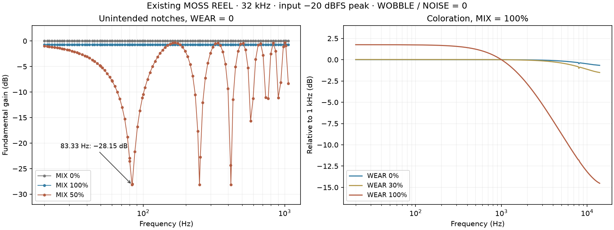

# REEL: research and redesign plan

[Русский](REEL-RESEARCH-PLAN.md) · **English** · 15 November 2026

Status: research and proposed implementation. Production DSP, UI, application version and device were not changed. Baseline: 0.6.6-dev, commit `59c7cd217fd43acc8c63de9b39ab39134913f38b`. This supersedes the earlier eight-parameter REEL proposal in the [Elektron research](ELEKTRON-FX-RESEARCH.en.md), not the controls available in the current application.

## 1. What REEL is based on

The existing REEL is an original, simplified MOSS effect: modulated delay, one filter, soft limiting and noise. It is not a port of GrainBrick, RC-20 or recovered Elektron Warble code. Previous Elektron research informed control and architectural ideas; the complete Warble mathematical kernel remains unknown.

The new design separates its references: GrainBrick for processing structure and visual metaphor; official RC-20 documentation for independent character controls; CHOW Tape and published modelling work for DSP mechanisms; our own implementation, measurements and RG35XX qualification for the actual product.

## 2. Why the current effect can remove frequencies

The probe includes the [production effect](../native/prototype/src/effects.h) directly. [Source, CSV, plots and hashes](verification/reel-baseline/README.md) are provided for reproduction.

| Finding | Consequence |
|---|---|
| A fixed 6 ms delay remains at WOBBLE=0 | Dry and processed signals are misaligned |
| MIX combines those signals | Partial MIX produces comb filtering, including bass notches |
| WEAR couples filtering, distortion, level and slow amplitude variation | Character cannot be adjusted independently from darkness/dynamics |
| WEAR=0 retains filtering and nonlinear compression | The nominally clean setting is not neutral |
| WOBBLE adjusts two depths together | Neither oscillator rate is user controlled |
| Internal PCM16 storage clips to ±1 | Inter-effect headroom is lost |
| Linear fractional-delay interpolation | High-frequency amplitude depends on fractional position |

At 32 kHz, input peak −20 dBFS, WOBBLE=WEAR=NOISE=0:

| Setting | Fundamental gain relative to input |
|---|---:|
| MIX=50%, 83.333 Hz | **−28.15 dB** |
| MIX=50%, 250 Hz | **−28.14 dB** |
| MIX=100%, 83.333 Hz | −0.71 dB |
| MIX=100%, 1 kHz | −0.71 dB |
| MIX=100%, 12 kHz | −1.31 dB |

At WEAR=100 and MIX=100, measured 12 kHz is approximately **14.03 dB below 1 kHz**. WEAR also applies amplitude modulation, so this is a finite-window tone measurement, not an LTI frequency response.

Measured oscillator rates: **wow ≈0.30995 Hz, flutter ≈6.19988 Hz**. The code increments phase by `.62/rate` and `12.4/rate`, but its phase cycle spans two units. Those apparent frequency constants therefore produce half their numeric values. A 64-second wrap-count measurement confirms this.

This establishes a problem with **enabled REEL**, especially partial MIX. It does not explain the earlier bass complaint with all effects bypassed; that end-to-end measurement had a different result. Neither the analog output nor headphones were measured here.

## 3. GrainBrick findings and evidence boundaries

Inspected the [official beta 1.0.1, tag v1.0.1-beta.2](https://github.com/ETRNLIAM/GrainBrick/releases/tag/v1.0.1-beta.2), archive SHA-256 `e2d985f7a99b8f123b0d39369b47bc8ed7b72be4a2296cc5f7ed2c8682518d7a`. The [repository](https://github.com/ETRNLIAM/GrainBrick) explicitly says the application source is closed. This is distribution analysis, not access to its original source tree.

### Native processing: static binary inspection

`libgrainbrick_tape.so` is a small ARM64 library exporting create/set-parameters/process/clear functions. The main application is a compiled Python 3.12 module; its distribution README identifies Nuitka. Its platform and stack differ from MOSS ARMv7/Garlic.

Observed without copying implementation into MOSS:

- Stereo float32 processing and a ring history. Creation returns a global state address; that singleton cannot directly serve five independent MOSS chains.
- Separate saturation, movement, noise, dropout and damage paths. The demo project stores saturation/wow/flutter/hiss/dropout/crinkle/bit8/enabled.
- Smoothed random targets for slow and fast movement, with interpolation through a processing block: more varied than MOSS's two unchanging sines.
- Linear fractional-delay reads. The inspected path contains an approximately 12 ms base term and delay bounds; this does not establish transparent dry/wet behavior.
- Rational soft-saturation curves and previous-sample processing. No Jiles–Atherton solver was identified in the inspected path; a physically exact magnetic model is not established.
- Block-level preparation, but some processing branches still call `sinf`/`powf`. Native code alone does not establish affordable worst-case RG35XX performance.

Ghidra import addresses for reproduction: `gbtape_create` 0x0011074c, `gbtape_set_parameters` 0x001109ec, `gbtape_process` 0x00110a2c, `gb_sat_coeffs` 0x00112570, `gb_process_saturation` 0x001127f4. Decompiled types are approximate, particularly SIMD expressions; full parameter-to-coefficient reconstruction is not claimed. This library was not executed on RG35XX or compared against MOSS with matched audio inputs. Third-party binaries and decompiled output remain in ignored local research storage.

### Animation: directly observed, distinct from processing

The [author's tutorial at 4:12–4:23](https://www.youtube.com/watch?v=Iy-IeH4_EvQ&t=252s), including frames 4:16 and 4:19, shows two flat three-spoke reels, changing angular positions, a curved connecting tape and a central square. A rough signal-like line appears on the tape during processing; eight small controls sit below.

Main-module strings identify reel angles/velocities, audio-wave and visual-saturation state, and tape-animation update functions. Names are evidence of these elements, **not proof of their exact audio mapping**. The full animation algorithm was not recovered. Rotation is not established as a calibrated flutter display, nor is the line established as a faithful oscilloscope.

Borrow the readable tape-path metaphor, not the complete screen. Eight-bit degradation remains CRUSH's responsibility; MOSS retains four visible parameter fields.

## 4. RC-20 reference

The [official module description](https://support.xlnaudio.com/hc/en-us/articles/16382602368541-Interface-overview-FX-Module-section) documents independent Wow and Flutter Rate controls, an overall amount, their balance and stereo behavior. Distort's Focus allows frequency-selective distortion, including preservation of the bottom end. These are behavioral specifications, not disclosed DSP formulas.

The [v1 manual](https://assets.xlnaudio.com/documents/rc-20-retro-color_manual.pdf) distinguishes Magnetic's **amplitude** wear/flutter/dropouts from Wobble's pitch/speed variation. Noise has independent tone/follow/duck and routing; Flux adds irregularity, Magnitude controls overall intensity. Our controls should likewise distinguish spectrum, pitch and loudness.

[RC-20 v2](https://support.xlnaudio.com/hc/en-us/articles/40377279553949-Update-RC-20-Retro-Color-v2) is already published at the research date, adding Tape/Classic Pre/Porta distortion types, Warp, expanded Loss, movable modules and loudness matching. These additions must not be attributed to v1. Echo/Space/Codec/Grains are outside REEL's scope: MOSS already has corresponding separate tools.

The product lesson is independent mechanisms, an overall character amount and level-matched comparison. No licensed RC-20 instance was measured in this work; identical sound is not promised.

## 5. Proposed audio contract

Cover clean/full recording, gently drifting ambient tape, and clearly damaged/noisy tape. The clean setting must exist without obligatory low-pass, hiss or saturation.

Candidate processing order: input, reversible pre-emphasis, saturation, inverse emphasis, wow/flutter, independent BUMP/TONE/LOSS, dropout, controlled hiss, OUTPUT. Confirm noise placement through listening; the first version gets one understandable routing rather than another routing matrix.

### MIX, AMOUNT and latency: first architectural gate

Prefer replacing REEL **MIX with AMOUNT**, visibly renamed. It scales movement depths, drive, tone deviation, bump, loss, drop and noise level rather than summing undelayed audio with a moving copy. Rates, stereo, follow and OUTPUT stay independent. AMOUNT=0 is neutral **after aligned latency**, at OUTPUT=0 dB.

Delaying dry by the fixed base delay removes the static comb, but moving wet relative to dry still creates chorus. That is not a complete solution; an intentional chorus/blend could be a separate future mode.

Modulated delay still needs causal latency. First compare a **16 ms** base supporting slow/deep wow with a 6 ms candidate and narrower wow range, before completing the UI:

1. Measure interpolation/motion bounds and audition bass, transients and pads.
2. For 16 ms, compensate track baselines at the mixer. Master processing adds a common delay; REEL on both a track and master adds up to 32 ms beyond existing buffering.
3. Locks, page navigation and bypass must not change the baseline. Preserve aligned timing on bypass. Effect insertion/removal, SONG and preview need warm-history transition handling and separate measurements; do not silently move a single hit relative to other tracks.
4. Account for latency in playheads, meters and resampling without double compensation in saved audio.
5. If device interaction suffers, select the short candidate with explicitly revised depth/rate ranges. No hidden depth clamp or accidental chorus substitute.

### Movement

- Separate rate and depth. Initial long-delay candidate: WOW 0.10–4.00 Hz, FLUTTER 2–30 Hz, each 0–15 cents. These are proposed MOSS ranges, not RC-20 specifications.
- For `y(t)=x(t−D(t))`, instantaneous speed is `1−D′(t)`. At fixed pitch depth, sinusoidal delay amplitude is inversely proportional to LFO frequency. Otherwise RATE also changes pitch depth unintentionally.
- 15 cents at 0.10 Hz needs roughly 13.85 ms wow amplitude; flutter at 2 Hz adds about 0.69 ms. Six milliseconds cannot accommodate this range. Explicitly budget headroom and interpolation guards.
- DRIFT blends regular motion with bounded smooth random trajectories. Bound amplitude **and derivative**; avoid unbounded random walks. Measure random pitch distribution separately.
- Rate changes continuously; notes/locks do not reset phase. Channels start linked; STEREO introduces movement differences, tested in mono.
- Compare four-point interpolation against linear and a higher-quality offline reference. Cubic interpolation does not remove Doppler pitch motion; the latter is intentional here.

### Saturation and spectrum: a separate development pass

- Compare soft saturation plus level-dependent thickening and reversible pre/post-emphasis. Do not simply reuse DRIVE with an obligatory dull filter.
- DRIVE=0 bypasses the nonlinearity exactly. Neutral TONE/BUMP/LOSS must be spectrally neutral. Remove internal PCM16 clipping and the mandatory low-pass.
- TONE is an independent high shelf with a neutral center, not necessarily a bass-cutting tilt. LOSS intentionally reduces bandwidth. BUMP is a broad controlled bass lift, not a patch for accidental bass cancellation.
- Compare ADAA, including its own coloration, against local 2× oversampling of the nonlinear stage only. Do not oversample the entire chain by default.
- Link stereo dynamics. If asymmetry requires DC removal, use a very low cutoff and measure 20 Hz loss; do not insert an unnecessary filter otherwise.
- Keep explicit OUTPUT and level-matched A/B. Automatic gain pumping or louder output must not disguise inferior tone.

[CHOW Tape's manual](https://chowdsp.com/manuals/ChowTapeManual.pdf) distinguishes hysteresis, pre/post-emphasis, head losses and motion; its physical model carries computational tradeoffs. A full Jiles–Atherton solver is outside the first implementation without measured need and cost. The [open project](https://github.com/jatinchowdhury18/AnalogTapeModel) is a study reference; incorporating its GPL code would be a separate decision and has not occurred here.

### Noise and damage

HISS has its own TONE and FOLLOW. FOLLOW=0 produces steady noise during active transport; FOLLOW=100 follows the signal envelope more strongly. Fade noise on STOP/project changes without cutting effect tails. DROP produces occasional smoothly shaped amplitude dips, not pitch flutter or high-pass filtering. Dropouts initially remain stereo-linked. Random processes must be reproducible in tests and independent between effect instances.

Defer CRINKLE, hum, separate amplitude flutter and cassette models until listening identifies a specific missing capability. Quality of the main operating range takes priority over control count.

## 6. Controls and states

Four pages, physical button order **Y / B / A / X**. These are initial test ranges, not currently implemented functionality.

| Page | Y | B | A | X |
|---|---|---|---|---|
| COLOR | DRIVE 0–100% | TONE −6…+6 dB | BUMP 0…+6 dB | AMOUNT 0–100% |
| MOTION | WOW 0–15 cents | WOW RATE 0.10–4 Hz | FLUTTER 0–15 cents | FLT RATE 2–30 Hz |
| LIFE | DRIFT 0–100% | STEREO 0–100% | LOSS 0–100% | DROP 0–100% |
| OUTPUT | HISS OFF / −72…−24 dBFS* | HISS TONE −100…100 | FOLLOW 0–100% | OUTPUT −12…+6 dB |

*Noise level denotes generator RMS at neutral tone and FOLLOW=0, not acoustic loudness; subsequent tone/follow/source interaction changes actual output RMS. Initial BUMP center approximately 80 Hz, broad bandwidth; TONE shelf approximately 3 kHz; LOSS transitions from true bypass to intentional bandwidth reduction. Tune these independently of motion.

SPACE → REEL opens COLOR. Short L1/R1 changes page. Hold a parameter button with ←/→ for fine adjustment, ↑/↓ for coarse. WOW RATE uses 0.01/0.1 Hz; FLT RATE 0.1/1 Hz. Other fractional values use tenths where integer steps would be excessive.

FX LOCKS retains L1+←/→ for effect selection, L1+↑/↓ for its page. Same labels, units, colors and ranges. Lock-only alters an existing voice without restarting phase, noise RNG, envelope or history. CLEAR CURRENT LOCK BANK affects only four visible fields; INHERIT and explicit RESET retain distinct meanings. Bank names are effect-specific; verify all four tabs fit 640×480 instead of extending the current two-bank layout beyond the screen.

| State | Feedback and recovery |
|---|---|
| First enable | Clean initial state; no surprise hiss |
| Open while stopped | Editable values, calm illustration, no invented signal |
| BYPASS | Explicit label, subdued drawing, aligned latency and no large callback clear |
| Live adjustment | Immediate target value, smoothed audio; target is not presented as a measured instantaneous value |
| Lock on sustained note | Visible local value/page, uninterrupted note and phase |
| Navigate away/back | Preserve page selection; no unnecessary menu items |
| Save failure | Retain session edits, show failure rather than false success |
| Old project | Backup and explicit data version; no silent parameter reinterpretation |

Keep the established graphite palette and four button colors. Labels/numbers remain sufficient without color or animation.

## 7. MOSS visualization

A small flat two-reel/tape/head diagram within the existing effect illustration area. No deck housing, gradients, grain background, highlights or decorative meters.

- Reels indicate transport and slow speed changes, not remaining tape capacity: REEL has no finite cassette.
- The central square is a head, not a sample-position cursor. Show a short history of actual output/envelope along the connecting tape.
- A thin speed trace uses actual delay change. At UI 20 FPS, 20–30 Hz flutter cannot be faithfully represented by reel rotation alone: show min/max history and numeric Hz to avoid misleading visual aliasing.
- TONE/LOSS do not shake reels. DROP weakens the corresponding trace; noise representation must reflect measured contribution. Do not silently auto-amplify a quiet trace into apparent loud audio.
- Publish compact nonblocking telemetry snapshots. Cache contours, bound point counts, allocate nothing per frame, use no FFT, draw only the visible effect.
- Reduced/stopped animation preserves labels and measurements. Verify that disabling graphics leaves audio bit-identical.

GrainBrick supports the visual metaphor; the specific DSP mapping above is **our proposed design**, not a claim about GrainBrick's internals.

## 8. Architecture, storage and compatibility

Extract `ReelDSP` with bounded prepare/process/reset/telemetry operations and per-instance state. Centralize control ranges, steps, defaults, page names and mappings. Do not build a general plugin graph for one effect.

Prepare expensive coefficients outside the sample loop. Schedule random events in sample time, independent of callback size. Use fixed float32 histories and logical resets; no file access, allocation, mutex or large clearing in audio callbacks. End-of-chain protection is distinct from artistic saturation.

**Do not double every lock array.** Current storage is 5×8=40 FX values per step. Required counts become ORBIT 8 + POND 4 + CRUSH 4 + REEL 16 + DRIVE 8 = **40**. Prefer compact storage with centralized offsets/counts and stable effect/parameter IDs, retaining 80 bytes per step rather than 160. Physical layout must not define the external format or command identity. Small DSP working tables may remain rectangular.

Audit `type*EffectParameters` addressing, commands, validation, serialization and SONG/scene copies. Introduce a data-format version with explicit MS12 reading. Old WOBBLE/WEAR/MIX cannot map exactly; retain original projects and the previous binary, document approximate REEL conversion instead of silently changing meaning. Do not delete current sequences for implementation convenience.

Initial aggregate target for extra delay/compensation/telemetry storage: **≤256 KiB across five chains**. Verify actual `sizeof`, peak RSS and maximum SONG; this is a proposed budget, not a measured implementation.

## 9. Implementation sequence and acceptance

| Stage | Deliverable | Gate |
|---|---|---|
| 0 — completed | 3078 tone measurements, oscillator rates, reference findings | Reproducible evidence; production unchanged |
| 1 | Two neutral/latency/AMOUNT candidates and float history | No static comb notches; track/bypass/preview timing resolved |
| 2 | Independent rate/depth, bounded drift, stereo | Correct Hz and pitch depth; dense locks without discontinuities |
| 3 | Two saturation candidates; independent TONE/BUMP/LOSS | Spectral checks and level-matched listening |
| 4 | HISS/FOLLOW/DROP, 4–6 useful presets | No clicks, stale history, DC or uncontrolled output |
| 5 | Four banks, locks, persistence/SONG, visualization | Sustained granular note → lock-only → bypass → save/reopen workflow |
| 6 | Device A/B and long maximum-load qualification | Evidence for the exact binary offered to the user |

Audio acceptance:

- Neutral, after latency compensation, ≤1e−6 float error with all coloration zero; no noise/filtering. Test exact bypass separately.
- At the 32 kHz product rate, target ±0.25 dB across 20 Hz–12 kHz without intentional color; investigate 12–14 kHz separately. Do not promise 20 kHz at a 16 kHz Nyquist frequency.
- With motion, measure pitch distribution and energy including sidebands; reduction of the original spectral line alone is not evidence of volume loss.
- Regular LFO frequency error <1%; pitch depth within 10% of target. Random DRIFT gets statistical limits, not a fictitious fixed period.
- DC, impulses, silence/noise, bass, varied signal levels, high tones, intermodulation and aliasing. The chosen anti-aliasing method must improve a defined set over naive shaping without unexplained HF loss; publish actual results.
- 20/32/44.1/48 kHz with passbands limited by each Nyquist frequency, blocks 1/127/1024, extreme controls, rapid lock-only, STOP/START, reset, reorder, SONG and old projects. Sample-source rates up to 96 kHz belong in full-engine tests separately.
- Listening: sub/bass, dry drums, pad, noisy granular and dense mix. Compare original, old REEL and candidate; match stationary excerpts to approximately 0.2 dB RMS, evaluate transients/silence separately. Neither a graph nor louder output proves better sound.

Performance:

The latest [SWING qualification](SWING-v1.en.md) reached 29.236 ms against a 32 ms deadline. This was POND+DRIVE, so compare both the whole application's upper bound and matched REEL profiles: earlier short REEL+DRIVE and POND+REEL runs reached 23.040 and 23.696 ms. Subtracting different runs is not a guaranteed budget.

Use four maximum-length tracks, eight grains each or all four sampler slots per instance, two active effects per track and two on master. Run **five REEL instances**, each possible companion effect and mixed orders, maximum character/motion controls, dense locks across all pages, SWING/SHIFT/REPEAT, SONG, SD resampling and the visible animated effect.

Early target: ≤1.5 ms additional aggregate cost for five new REEL instances against matched old-REEL profiles; profile before UI integration if exceeded. Release gate: no over-budget callbacks, underruns or late audio intervals in stress qualification, and no regression against the verified build. Reserve target: p99≤24 ms and maximum≤28 ms. Missing that reserve remains an explicitly unresolved item, not a claim of stability under every load. Final heaviest soak: at least 20 minutes, plus the scenario matrix and a reboot repeat.

No hidden voice/effect disabling or load-dependent quality changes. First optimize coefficient preparation and measured hot paths, then choose a single fixed-quality nonlinear implementation. Any reduction in product capabilities requires a separate decision.

## 10. Open decisions and next action

Resolve 16 ms/wider wow versus short latency first; choose anti-aliasing and saturation together from audio/CPU evidence; tune color curves and presets through listening. GrainBrick and RC-20 have not been measured on matched inputs, so neither identity nor superiority is established.

Next practical step: **an isolated neutral + WOW/FLUTTER audio candidate**, with renders and measurements, before modifying the user build. The console is unnecessary for this research and is needed only for the later hardware stage.
