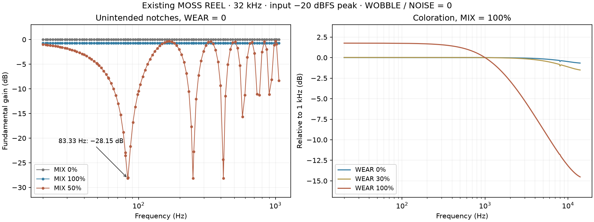

# REEL: исследование и план новой обработки

**Русский** · [English](REEL-RESEARCH-PLAN.en.md) · 15 ноября 2026

Продолжение: [реализованный аудиокандидат чистого тракта и WOW/FLUTTER](REEL-MOTION-v1.md), включая аппаратные результаты. Следом реализованы [насыщение, окраска и оптимизация](REEL-COLOR-v1.md). По указанию пользователя стандартная проверка — короткая целевая серия 2–3 минуты. Остальной документ сохраняет исходное обоснование и план полного REEL.

Статус: исследование и предложение к реализации. Производственный DSP, интерфейс, версия приложения и консоль не менялись. Исходная сборка — 0.6.6-dev, commit `59c7cd217fd43acc8c63de9b39ab39134913f38b`. Этот документ заменяет прежнее предложение из восьми параметров REEL в [исследовании Elektron](ELEKTRON-FX-RESEARCH.md), но не меняет фактически доступные параметры текущей версии.

## 1. На чём основан REEL

Существующий REEL — собственная упрощённая обработка MOSS: модулируемая задержка, один фильтр, мягкое ограничение и шум. Он не основан на перенесённом алгоритме GrainBrick, RC-20 или восстановленном Warble Elektron. Предыдущий разбор Elektron дал ориентиры по управлению и архитектуре; полное математическое ядро Warble не установлено.

Для новой версии разделяем источники:

- **GrainBrick:** публичная готовая сборка и видео автора — устройство эффекта, случайное движение, образ ленты в интерфейсе.
- **RC-20:** официальное описание регуляторов и поведения отдельных модулей — удобство независимого управления характером.
- **CHOW Tape / опубликованная модель:** объяснение физических механизмов и компромиссов DSP.
- **MOSS:** собственная реализация, собственные измерения и проверка стоимости на RG35XX. Сходство с референсом не заменяет эти проверки.

## 2. Почему нынешний REEL может «резать частоты»

Проверен непосредственно [производственный код](../native/prototype/src/effects.h), а не его переписанная имитация. [Probe, CSV, график и контрольные суммы](verification/reel-baseline/README.md) позволяют повторить измерение.

| Наблюдение | Что происходит | Последствие |
|---|---|---|
| Постоянная задержка 6 ms | Есть даже при WOBBLE=0 | Оригинал и обработанная ветвь не совпадают по времени |
| MIX складывает эти две ветви | На частичном MIX появляется гребенчатая окраска | Выпадают отдельные частоты, включая бас |
| WEAR меняет сразу несколько вещей | Частоту фильтра, перегруз, уровень и медленную амплитудную модуляцию | Нельзя добавить характер отдельно от затемнения/динамики |
| WEAR=0 не нейтрален | Фильтр и нелинейность остаются | Даже «чистая лента» меняет звук и громкость |
| WOBBLE управляет двумя глубинами | Скорости wow/flutter фиксированы | Нельзя выбирать медленное плавание или характер быстрой дрожи |
| Запись во внутренний PCM16 | Перед записью ограничение до ±1 | Теряется запас уровня между эффектами |
| Линейная дробная интерполяция | Амплитуда верхов зависит от дробной позиции | Дополнительная окраска при движении головки |

При 32 kHz, входном синусе с пиком −20 dBFS, WOBBLE=WEAR=NOISE=0:

| Условия | Результат относительно входа |
|---|---:|
| MIX=50%, 83.333 Hz | **−28.15 dB** основной частоты |
| MIX=50%, 250 Hz | **−28.14 dB** |
| MIX=100%, 83.333 Hz | −0.71 dB |
| MIX=100%, 1 kHz | −0.71 dB |
| MIX=100%, 12 kHz | −1.31 dB |

При WEAR=100, MIX=100 измеренный уровень 12 kHz примерно на **14.03 dB ниже 1 kHz**. Это конечное измерение по тонам: WEAR также модулирует амплитуду, поэтому его нельзя выдавать за частотную характеристику линейной неизменной системы.

Фактические частоты осцилляторов: **wow ≈0.30995 Hz, flutter ≈6.19988 Hz**. В коде стоят приращения `.62 / rate` и `12.4 / rate`, но фаза проходит диапазон длиной два, поэтому реальные частоты вдвое меньше этих чисел. Это подтверждено счётчиком полных периодов за 64 секунды.

Это доказанная проблема **включённого REEL**, особенно частичного MIX. Она не объясняет прежнюю жалобу на бас при полностью выключенных эффектах: тот сквозной тест дал другой результат. Аналоговый выход и наушники в этой работе не измерялись.

## 3. Что удалось установить о GrainBrick

Проверена [официальная beta 1.0.1, tag v1.0.1-beta.2](https://github.com/ETRNLIAM/GrainBrick/releases/tag/v1.0.1-beta.2). SHA-256 архива: `e2d985f7a99b8f123b0d39369b47bc8ed7b72be4a2296cc5f7ed2c8682518d7a`. [Репозиторий](https://github.com/ETRNLIAM/GrainBrick) прямо сообщает, что исходники приложения закрыты. Поэтому это анализ распространяемых файлов, а не чтение оригинального исходного проекта.

### Движок: статический анализ бинарного модуля

В архиве есть `libgrainbrick_tape.so`: небольшой ARM64-модуль с экспортами `gbtape_create`, `gbtape_set_parameters`, `gbtape_process`, `gbtape_clear`. Основное приложение — скомпилированный модуль Python 3.12; документация сборки указывает Nuitka. Это другой программный стек и другая платформа, чем ARMv7/Garlic MOSS.

Подтверждённые наблюдения по библиотеке, без переноса её кода:

- Выделенный stereo float32 тракт и кольцевая история. Создание возвращает адрес глобального состояния; переносить такой singleton в пять независимых цепочек MOSS нельзя.
- Отдельные ветви насыщения, движения, шума, выпадений и повреждений. В демопроекте сохранены saturation / wow / flutter / hiss / dropout / crinkle / bit8 / enabled.
- Случайные цели медленного и быстрого движения, их сглаживание и переход между значениями внутри блока. Это богаче двух неизменных синусоид MOSS.
- Дробное чтение задержки с линейной интерполяцией. В рассмотренном пути видна базовая составляющая около 12 ms и ограничение диапазона задержки; это не доказательство прозрачного dry/wet.
- В насыщении есть рациональные мягкие кривые и обработка предыдущего состояния. В рассмотренном коде не обнаружена модель Jiles–Atherton; называть это физически точной эмуляцией магнитной ленты оснований нет.
- Параметры подготавливаются на границе блока, но отдельные ветви всё равно используют `sinf`/`powf` внутри обработки. Наличие native-библиотеки само по себе не доказывает её пригодность для нашего максимума нагрузки.

Адреса для воспроизводимого частичного разбора: `gbtape_create` 0x0011074c, `gbtape_set_parameters` 0x001109ec, `gbtape_process` 0x00110a2c, `gb_sat_coeffs` 0x00112570, `gb_process_saturation` 0x001127f4 в использованном импорте Ghidra. Декомпилятор приблизительно восстанавливает типы, особенно ARM SIMD: полное отображение всех коэффициентов не заявляется. Бинарник на RG35XX не запускался; A/B его звука и MOSS не проведено.

### Анимация: наблюдение видео, отдельно от DSP

В [официальном туториале, 4:12–4:23](https://www.youtube.com/watch?v=Iy-IeH4_EvQ&t=252s) просмотрены кадры 4:16 и 4:19: две плоские катушки с тремя спицами, меняющееся угловое положение, дуга ленты между ними и небольшой квадрат в центре. При включённой обработке на дуге появляется неровная линия. Под ней — восемь компактных регуляторов в два ряда.

В строках основного модуля найдены имена отдельных состояний угла/скорости катушек, audio wave, visual saturation и обновления tape animation. **Это подтверждает наличие таких элементов, но не доказывает точное соответствие каждой детали аудиосигналу.** Полный код анимации не восстановлен. В частности, по видео нельзя заключить, что её скорость — точное измерение flutter или что неровности являются достоверной осциллограммой.

Для MOSS полезна визуальная идея ленты как пути сигнала. Не переносим экран целиком, цифровое ухудшение 8BIT оставляем CRUSH, а перегруженную сетку из восьми ручек заменяем знакомыми четырьмя полями.

## 4. RC-20: что именно берём за ориентир

В [официальном описании модулей](https://support.xlnaudio.com/hc/en-us/articles/16382602368541-Interface-overview-FX-Module-section) у Wobble описаны **отдельные Rate для Wow и Flutter**, общий уровень, баланс медленного/быстрого движения и stereo-вариант. Distort позволяет ограничить диапазон обработки через Focus; низ можно оставить менее искажённым. Это описание поведения, не раскрытие DSP-кода.

По [руководству RC-20 v1](https://assets.xlnaudio.com/documents/rc-20-retro-color_manual.pdf): Magnetic управляет изменениями **громкости**, включая wear/flutter/dropouts; Wobble — высотой тона и скоростью. Noise имеет отдельные tone/follow/duck и положение до/после цепочки. Flux добавляет нерегулярность, Magnitude управляет общей интенсивностью. Эти механизмы нельзя смешивать в единственный WEAR: пользователь должен понимать, что меняет спектр, высоту или громкость.

На дату исследования уже опубликована [RC-20 v2](https://support.xlnaudio.com/hc/en-us/articles/40377279553949-Update-RC-20-Retro-Color-v2): появились дополнительные Tape/Classic Pre/Porta варианты distortion, Warp, новые возможности Loss, перестановка модулей и loudness matching. Это отдельная версия, её новые параметры не приписываем v1. Переносить в REEL её Echo, Space, Codec и Grains не нужно: у MOSS есть собственные ORBIT, POND, CRUSH и GRANULAR.

**Вывод для нашего продукта:** независимые механизмы, удобный общий уровень характера, сравнение при равной громкости. Точное совпадение звучания RC-20 не обещаем; тестовой лицензированной копии в этом исследовании не использовали.

## 5. Предлагаемый звуковой контракт

Нужны три области характера: почти чистая плотная запись; мягкая плавающая ambient-лента; явно повреждённая, шумная и нестабильная лента. Чистый вариант обязан существовать без обязательного low-pass, шума и перегруза.

Предлагаемая последовательность обработки: вход → обратимая предкоррекция → насыщение → обратная коррекция → wow/flutter → независимые BUMP/TONE/LOSS → dropout → управляемый hiss → OUTPUT. Окончательное положение шума фиксируем после прослушивания; в первой версии один понятный вариант, без дополнительной матрицы маршрутизации.

### Главная развилка: MIX и задержка

Предпочтение — заменить в REEL **MIX на AMOUNT**, явно переименовав регулятор. AMOUNT масштабирует глубины механизмов: движение, drive, отклонение tone, bump, loss, drop и уровень шума. Он не складывает незадержанный оригинал с движущейся копией. Скорости, stereo, follow и OUTPUT не масштабируются. При AMOUNT=0 результат нейтрален **с учётом согласованной задержки**, OUTPUT=0 dB.

Простое добавление 6 ms к dry устраняет постоянную гребёнку, но при движении wet относительно dry всё равно создаёт chorus. Поэтому «задержать dry» не является полным решением этой задачи. Если позже нужен именно chorus/blend, это отдельный явно названный режим.

У модулируемой задержки остаётся причинная базовая задержка. Предварительный кандидат — **16 ms на REEL** для медленного wow с заметной глубиной; второй кандидат — 6 ms с более узким диапазоном wow. Выбор — первый обязательный эксперимент, до основного UI:

1. Измерить диапазон движения и интерполяцию обоих кандидатов, послушать бас, транзиенты, длинный pad.
2. Для 16 ms согласовать базовую задержку дорожек на входе микшера; мастер добавляет общий сдвиг. Максимум при REEL и на дорожке, и на мастере — 32 ms дополнительно к существующей буферизации.
3. Задержка не прыгает от локов AMOUNT/DEPTH, смены страницы или bypass. Bypass сохраняет согласованное время. Добавление/удаление эффекта, SONG и preview требуют отдельной схемы перехода с прогретой историей и измерения; нельзя незаметно сдвигать один удар относительно других.
4. Учитывать задержку в playhead/измерителях и ресэмплинге, не добавлять её повторно в файл при компенсации.
5. Если задержка/переходы неудобны на устройстве, выбрать короткий кандидат с явно пересмотренными диапазонами. Не скрывать ограничение глубины и не подменять его внезапным chorus.

### WOW / FLUTTER

- Отдельные глубина и частота каждого механизма. Предварительные диапазоны длинного кандидата: WOW 0.10–4.00 Hz, FLUTTER 2–30 Hz; глубины 0–15 cents. Это наши проектные диапазоны, не заявленные пределы RC-20.
- Глубина задаётся в слышимом отклонении высоты, а не только в миллисекундах задержки. Для `y(t)=x(t−D(t))` мгновенная скорость равна `1−D′(t)`: при синусоидальном движении нужная амплитуда задержки обратно пропорциональна частоте LFO. Иначе увеличение RATE незаметно увеличивает и глубину pitch.
- На 0.10 Hz и 15 cents требуется около 13.85 ms амплитуды wow; flutter 15 cents на 2 Hz добавляет около 0.69 ms. Поэтому 6 ms не покрывают весь предложенный диапазон. Буфер и запас для интерполяции рассчитываются явно.
- DRIFT плавно меняет регулярное движение в ограниченное случайное. Это смесь нормированных траекторий с ограничением амплитуды **и производной**, а не добавление безграничного random walk. Спектр и глубину случайного варианта измеряем отдельно.
- Частота меняется непрерывно, фаза не сбрасывается локом или новой нотой. Стереоканалы связаны по умолчанию; STEREO постепенно вводит различие только движения. Моносовместимость проверяется на крайних значениях.
- Проверить 4-точечную интерполяцию против линейной и более точного эталона. Кубическая интерполяция не отменяет доплеровское изменение высоты: здесь оно является нужным эффектом.

### Насыщение и частотный баланс — отдельная работа

- DRIVE не должен быть тем же DRIVE-эффектом с обязательным глухим фильтром. Сравнить мягкое ограничение с зависящим от уровня уплотнением, обратимой пред-/посткоррекцией и калиброванным усилением.
- При DRIVE=0 нелинейная стадия точно обходится. Нулевые TONE/BUMP/LOSS не меняют спектр. Убрать прежний обязательный low-pass и ограничение PCM16 внутри REEL.
- TONE — независимая полка высоких частот с нейтральным центром; она не обязана уменьшать низ при добавлении верха. LOSS — явно слышимая потеря верхов/полосы, только по желанию. BUMP — широкое контролируемое усиление низов, не компенсация случайно потерянного баса.
- Сравнить два дешёвых антиалиасинговых кандидата: ADAA с контролем собственной окраски и локальный 2× oversampling только нелинейной стадии. Не включать oversampling всей цепочки по умолчанию.
- Общую стереодинамику связывать, не создавать случайное плавание панорамы. При асимметрии удалять DC с очень низкой частотой и измерять потери на 20 Hz; без асимметрии не добавлять ненужный фильтр.
- Нужен честный OUTPUT и A/B при согласованной громкости. Не маскировать ухудшение звука повышением уровня или автоматически качающим громкость AGC.

В [CHOW Tape](https://chowdsp.com/manuals/ChowTapeManual.pdf) разделены гистерезис, пред-/посткоррекция, потери головки и движение; полноценная физическая модель требует отдельного вычислительного бюджета. Для MOSS это исследовательский ориентир. Полный Jiles–Atherton solver не входит в первую реализацию без доказанной необходимости и замеров. [Открытый проект](https://github.com/jatinchowdhury18/AnalogTapeModel) полезен для изучения и сравнения; заимствование его GPL-кода было бы отдельным решением, здесь оно не сделано.

### Шум и повреждения

HISS — окрашенный шум с собственным TONE и FOLLOW. FOLLOW=0 даёт постоянный фон при активном транспорте, FOLLOW=100 сильнее следует огибающей сигнала. При STOP/смене проекта шум уходит плавно; хвосты эффектов не обрываются. DROP управляет редкими плавно огибающимися провалами громкости; это не pitch flutter и не high-pass. В первой версии каналы выпадений связаны. Случайные процессы воспроизводимы в тестах и независимы между экземплярами.

CRINKLE, hum, отдельный amplitude-flutter и переключаемые модели кассет можно добавить позднее, если прослушивание обнаружит конкретную недостающую возможность. Сейчас важнее сделать основной диапазон качественным, а не заполнить экран ещё одним набором ручек.

## 6. Параметры и управление

Четыре страницы сохраняют порядок физических кнопок **Y / B / A / X**. Численные диапазоны ниже — стартовые для проверки, не обещание уже доступных функций.

| Страница | Y | B | A | X |
|---|---|---|---|---|
| COLOR | DRIVE 0–100% | TONE −6…+6 dB | BUMP 0…+6 dB | AMOUNT 0–100% |
| MOTION | WOW 0–15 cents | WOW RATE 0.10–4 Hz | FLUTTER 0–15 cents | FLT RATE 2–30 Hz |
| LIFE | DRIFT 0–100% | STEREO 0–100% | LOSS 0–100% | DROP 0–100% |
| OUTPUT | HISS OFF / −72…−24 dBFS* | HISS TONE −100…100 | FOLLOW 0–100% | OUTPUT −12…+6 dB |

*HISS dBFS: целевой RMS стационарного генератора при нейтральном HISS TONE и FOLLOW=0; тон, follow и сигнал могут изменить итоговый измеренный уровень. Не выдавать процент за точное акустическое измерение.

Начальные фиксированные точки: BUMP около 80 Hz с широкой полосой; TONE shelf около 3 kHz; LOSS от полного обхода к явному сужению полосы. Их форму выбираем прослушиванием и графиками, отдельно от WOW/FLUTTER.

Обычный путь: SPACE → REEL → COLOR; короткое L1/R1 меняет страницу. Кнопка параметра + ←/→ — тонкое изменение, + ↑/↓ — крупное. Для частот физическая шкала и единицы видны: WOW RATE тонко 0.01 Hz, крупно 0.1 Hz; FLT RATE 0.1/1 Hz. Без скрытого разгона частоты вслед за глубиной. Остальные дробные величины используют десятые там, где целый шаг слишком груб.

В FX LOCKS **L1+←/→** выбирает эффект, **L1+↑/↓** — одну из четырёх страниц REEL. Те же подписи, диапазоны и цвета. Lock-only меняет звучащую ленту без новой ноты; лок не перезапускает фазу, RNG, envelope или историю. CLEAR CURRENT LOCK BANK касается только четырёх видимых полей. Вернуть INHERIT и явно RESET — прежние разные операции. Названия банков зависят от эффекта; проверить размещение всех четырёх вкладок на 640×480 вместо растягивания текущей двухбанковой разметки за край экрана.

| Состояние | Обратная связь и поведение |
|---|---|
| Первое включение | Чистое начальное состояние; характер добавляется осознанно. Никакого внезапного hiss |
| Открытие без воспроизведения | Параметры доступны, рисунок спокоен; нет выдуманного сигнала |
| BYPASS | Явная подпись, приглушённый рисунок; задержка согласована, история не очищается в callback |
| Редактирование на ходу | Значение видно сразу, DSP плавно догоняет; UI не выдаёт цель за мгновенное измерение |
| Лок на длинной ноте | Видно локальное значение и страницу; фаза и нота продолжаются |
| Возврат/смена эффекта | Позиция страницы сохраняется в UI; не создаётся лишний пункт меню |
| Ошибка сохранения | Изменения остаются в текущей сессии, ошибка видна; не показывать успешное сохранение |
| Старый проект | Резервная копия, явная версия данных; никаких молчаливых подмен параметров |

Числа и подписи остаются читаемыми без цветового различения. Цвета четырёх кнопок — существующие, фон графит. Анимация не является единственным способом понять значение.

## 7. Анимация для MOSS

Предлагается небольшая плоская схема **две катушки → лента → головка**, в пределах существующей области рисунка эффекта. Без корпуса магнитофона, градиентов, зернистого фона, бликов и декоративных индикаторов.

- Катушки показывают работу транспорта и медленное изменение скорости. Не изображают количество оставшейся плёнки: REEL не хранит конечную кассету.
- Центральный квадрат — головка, а не курсор позиции сэмпла. На проходящем участке ленты — короткая история реального выходного сигнала/его огибающей.
- Отдельный тонкий след скорости строится из **реального изменения задержки**. Быстрый flutter при 20–30 Hz нельзя достоверно показать только вращением с UI 20 FPS: используем историю min/max и значение Hz, чтобы не создавать ложное медленное вращение из-за визуального алиасинга.
- TONE/LOSS не «шатать» катушки. DROP — краткое ослабление соответствующего участка, HISS — только измеренная шумовая составляющая при достаточном масштабе. При малом уровне не раздувать картинку до громкого сигнала без указания масштаба.
- Данные берутся компактным снимком из аудиодвижка без блокировки. Предрассчитанные контуры, ограниченное число точек, без FFT/новых выделений памяти на кадр. Рисуем только открытый эффект.
- Упрощённая/остановленная анимация сохраняет числа и след измерений; отключение визуализации не меняет звук. Проверить это побайтно.

Просмотр GrainBrick обосновывает метафору, но конкретная привязка визуализации к DSP выше — **наш проект**, не утверждение об устройстве GrainBrick.

## 8. Архитектура и память

Выделить `ReelDSP` из большого `FxState`, с фиксированными `prepare / process / reset / telemetry` и отдельным состоянием каждого экземпляра. Частоты, диапазоны, шаги, названия страниц и значения по умолчанию — один источник данных. Не строить универсальный граф плагинов ради одного эффекта.

Коэффициенты и дорогие преобразования — при изменении параметров/на управляющей частоте. События RNG — с определённым временем в отсчётах; результат не должен зависеть от размера аудиоблока. Ограниченные буферы float32, логический сброс, никаких файлов, malloc, mutex или полного очищения большого буфера в callback. Ограничение уровня в конце цепи не должно заменять художественный перегруз внутри неё.

**Не удваивать все массивы локов ради REEL.** Сейчас на шаг отведено 5×8=40 значений FX. Реальные количества после изменения: ORBIT 8 + POND 4 + CRUSH 4 + REEL 16 + DRIVE 8 = тоже **40**. Предпочтительно хранить их компактно с централизованными offset/count и доступом по стабильному ID эффекта/параметра. Раскладка в памяти не должна определять внешний формат и команды UI. Это сохраняет 80 байт FX-локов на шаг вместо роста до 160.

Потребуется проверить все обращения через `type*EffectParameters`, сериализацию, команды, валидацию и копирование SONG/сцен. Временные рабочие таблицы DSP можно оставить прямоугольными: их стоимость мала. Новая версия формата с явным чтением MS12; старые WOBBLE/WEAR/MIX не имеют точного соответствия новой модели. Сохранить исходные файлы и предыдущую сборку; приблизительное преобразование REEL должно быть явно описано. Не удалять текущие секвенции ради удобства разработки.

Предварительный верхний бюджет новых небольших задержек/компенсации/телеметрии — **до 256 KiB суммарно** на пять цепочек; подтвердить `sizeof`, пиковым RSS и максимальным SONG. Это цель, не замер готовой реализации.

## 9. Последовательность реализации и критерии

| Этап | Результат | Проверка перед следующим этапом |
|---|---|---|
| 0. Исходная точка — сделано | 3078 тоновых измерений, частоты LFO, описание референсов | Воспроизводимые файлы, production-код не изменён |
| 1. Чистый тракт и время | Два кандидата задержки/AMOUNT, float history, точный neutral | Нет постоянных гребенчатых провалов, согласованы дорожки/bypass/preview |
| 2. Движение | Независимые rate/depth, bounded drift, stereo | Скорость соответствует Hz; rate не меняет заданную глубину скрытно; плотные локи без разрывов |
| 3. Цвет | Сравнение двух вариантов насыщения, TONE/BUMP/LOSS отдельно | Частотные/спектральные измерения и A/B при равной громкости |
| 4. Живая лента | HISS/FOLLOW/DROP, 4–6 характерных пресетов | Никаких щелчков, утечки старой истории, DC или неконтролируемого уровня |
| 5. Управление и данные | Четыре банка, все локи, сохранение/SONG, рисунок | Полный сценарий с длинной гранулярной нотой, lock-only, bypass, повторным открытием |
| 6. RG35XX | Аппаратные A/B производительности и долгие максимальные прогоны | Отчёт по той же сборке, которая будет установлена пользователю |

**Звуковые тесты:**

- Neutral: после компенсации задержки ошибка ≤1e−6 float, если все цветовые механизмы нулевые; нет шума и фильтрации. Отдельно exact bypass.
- Полоса без намеренной окраски: 20 Hz–12 kHz, целевой разброс ≤±0.25 dB; 12–14 kHz исследовать отдельно при рабочей частоте 32 kHz. Не обещать 20 kHz при Nyquist 16 kHz.
- При движении измерять распределение pitch и энергию полос/боковых составляющих, а не ошибочно считать исчезновение исходной спектральной линии «потерей громкости».
- Частота регулярного LFO: ошибка <1%; глубина в cents — <10% от цели на контрольном тоне. Для DRIFT — отдельные статистические пределы, без обещания постоянного периода.
- DC, импульсы, шум, бас, синусы разных уровней, высокие ноты, интермодуляция и алиасинг. Антиалиасинговый кандидат должен выиграть у прямого waveshaper на согласованном наборе без необъяснённого завала верхов; численный результат публикуется, не заменяется словом «аналоговый».
- 20/32/44.1/48 kHz с учётом Nyquist каждой частоты, блоки 1/127/1024, крайние параметры и быстрые lock-only. Долгое молчание, STOP/START, reset, reorder, SONG, старые данные. Частоты исходных сэмплов до 96 kHz проверяются в полном движке отдельно.
- Прослушивание: чистый sub/bass, сухая драм-партия, pad, шумный granular и насыщенный полный микс. Чистый оригинал / старый REEL / кандидат, громкость согласована примерно до 0.2 dB RMS на стационарных отрывках; транзиенты и тишина проверяются отдельно. Не утверждать качество по одной громкости или графику.

**Нагрузка:** текущий [SWING-отчёт](SWING-v1.md) даёт худший блок 29.236 ms из 32 ms; это не большой запас. Этот максимум был в POND+DRIVE, поэтому новый REEL нужно сравнивать и с общей верхней границей, и с соответствующими REEL-парами: прежние REEL+DRIVE 23.040 ms, POND+REEL 23.696 ms в коротких профилях. Эти разные прогоны нельзя механически вычитать как гарантированный бюджет.

На устройстве — четыре дорожки максимальной длины, до восьми гранул на каждой либо все четыре ячейки каждого сэмплера, два включённых FX на каждой дорожке и два на мастере. REEL одновременно в **пяти** экземплярах; по очереди каждый второй эффект, затем смешанные порядки. Максимальные DRIVE/DRIFT/FLUTTER/LOSS, плотные локи всех страниц, SWING/SHIFT/REPEAT, SONG, ресэмплинг на SD, открытый анимированный REEL.

Ранний ориентир: добавочная стоимость пяти REEL относительно старых на сопоставимом профиле не больше 1.5 ms/блок; если выше — оптимизация до интеграции. Выпускной критерий: ноль over-budget/underrun/поздних аудиоинтервалов в нагрузочной серии и не хуже проверенной версии; цель запаса — p99≤24 ms, максимум≤28 ms. Если цель запаса не достигнута, это явно незакрытый пункт, а не «стабильно при любой нагрузке». Для текущих этапов применяются короткие целевые серии 2–3 минуты. Длинная выпускная проверка не запускается автоматически; её объём нужно определить отдельно перед выпуском.

Никаких скрытых отключений голосов/эффектов или автоматического снижения качества по CPU. При нехватке ресурсов сначала профилировать, переносить подготовку коэффициентов из горячего цикла, упрощать дорогую нелинейную стадию; затем выбирать один фиксированный качественный вариант. Уменьшение возможностей требует отдельного решения.

## 10. Что остаётся открытым

1. 16 ms с широким WOW или короткий вариант: решается измерением и ощущением игры, до обещания диапазонов.
2. Антиалиасинговая стадия и кривая насыщения: выбираются совместно по звуку/CPU, не по бренду референса.
3. Точные кривые TONE/BUMP/LOSS и музыкальные пресеты: прослушивание обязательно.
4. GrainBrick/RC-20 здесь не измерены на одинаковых входах; полная идентичность или превосходство над ними не доказаны.

Следующее практическое действие — **только автономный аудиокандидат чистого тракта + WOW/FLUTTER**, с рендерами и измерениями, до изменения пользовательской сборки. Консоль для текущего исследования не требуется; подключение понадобится для аппаратного этапа.
